# Wallex Trader Agent — final report (Phase 5: backtests, shadow, replay)

Assembled by `backtest/report.py` (`assemble_final_report`) from `../docs/REPORTS`; edit the source reports, not this file. Order: survey → backtests (candles, order books, AI ablation, walk-forward) → shadow → live → replay proof.

<!-- deliverables-index:start -->
## Deliverables index

Every folder and file under `deliverables/`, one line each (written by `scripts/make_deliverables.py`; rerun `python scripts/make_deliverables.py --index-only` after `backtest/report.py` rewrites this file). No live trading has happened yet, so there is no live decision log here. The decision trail below comes from runs on the SYNTHETIC feed (generated market data, not evidence of performance).

| path | what it is |
| --- | --- |
| [`REPORT.md`](REPORT.md) | this report: survey, backtests, AI ablation, walk-forward, shadow run, live run (none yet), replay proof |
| [`VIDEO.md`](VIDEO.md) | link to the demo video (PRD-06 §5) |
| [`TAGS.md`](TAGS.md) | git tags with their commits and time ranges: the engineering phases, `live-*` per live start, `final` |
| [`shadow_synth_4h/`](shadow_synth_4h/README.md) | Shadow run `shadow_synth_4h` — SYNTHETIC feed, real LLM |
| [`shadow_synth_4h/README.md`](shadow_synth_4h/README.md) | what the run is, commit, config hash, window, how to replay |
| [`shadow_synth_4h/decisions-20261022.jsonl`](shadow_synth_4h/decisions-20261022.jsonl) | decision records of 2026-10-22 (UTC): 18 lines (2 order, 2 outcome, 14 plan) |
| [`shadow_synth_4h/decisions-20261023.jsonl`](shadow_synth_4h/decisions-20261023.jsonl) | decision records of 2026-10-23 (UTC): 24 lines (24 plan) |
| [`shadow_synth_4h/orders-20261022.jsonl`](shadow_synth_4h/orders-20261022.jsonl) | order log of 2026-10-22 (UTC): 14 lines (2 cancel, 2 fill, 4 place, 4 response, 2 status) |
| [`shadow_synth_4h/events-20261022.jsonl`](shadow_synth_4h/events-20261022.jsonl) | engine events of 2026-10-22 (UTC): 1 start |
| [`shadow_synth_4h/events-20261023.jsonl`](shadow_synth_4h/events-20261023.jsonl) | engine events of 2026-10-23 (UTC): 2 ai_degraded, 1 ai_recovered, 1 day_start, 1 plan_stale, 1 stop |
| [`shadow_synth_4h/health.jsonl`](shadow_synth_4h/health.jsonl) | 6 heartbeats: the first of each UTC hour + the first and the last (all heartbeats are in the replay bundle) |
| [`shadow_synth_4h/journal.md`](shadow_synth_4h/journal.md) | Post-trade Reviewer journal: 4 hourly reviews |
| [`shadow_synth_4h/llm_cache/`](shadow_synth_4h/llm_cache/) | 86 cached LLM answers + 135 MCP/tool tape entries (`mcp_tape/`); the replay reads every plan from here |
| [`replay/`](replay/) | replay bundles: a recorded run + its state DB, checksummed, for `make replay-deliverable` without `logs/` or `data/` |
| [`replay/shadow_synth_4h/`](replay/shadow_synth_4h/README.md) | Replay bundle `shadow_synth_4h` — SYNTHETIC feed, real LLM |
| [`replay/shadow_synth_4h/README.md`](replay/shadow_synth_4h/README.md) | what the bundle holds, the checksums, how to replay by hand, and the replay output (PASS/FAIL) |
| [`replay/shadow_synth_4h/SHA256SUMS`](replay/shadow_synth_4h/SHA256SUMS) | sha256 of the two data files; `replay_check.py --bundle` refuses a bundle that does not match |
| [`replay/shadow_synth_4h/logs.tar.xz`](replay/shadow_synth_4h/logs.tar.xz) | the whole recorded log directory (decisions, orders, events, all heartbeats, journal, LLM cache, run.out), tar + xz |
| [`replay/shadow_synth_4h/state.sqlite.xz`](replay/shadow_synth_4h/state.sqlite.xz) | the run's state DB (ticks, books, candles, balances, fills the replay feeds back), SQLite online backup + VACUUM, xz -9 |

<!-- deliverables-index:end -->

> **Some sections below are built on SYNTHETIC DATA — not evidence of performance.** They are marked in the table and carry their own banner.

| # | section | status | source |
| --- | --- | --- | --- |
| 1 | Read first: what this evidence is and is not | included (2026-10-23) | [final_report_summary.md](../docs/REPORTS/final_report_summary.md) |
| 2 | Market survey (real recorded books) | included (2026-10-22) | [survey_20261022.md](../docs/REPORTS/survey_20261022.md) |
| 3 | Backtest: 1-min candles, 30 days, S2+S3 (SYNTHETIC) | included (2026-10-23) — SYNTHETIC | [bt_candles_30d/report.md](../docs/REPORTS/bt_candles_30d/report.md) |
| 4 | Backtest: 1-min candles, all recorded real candles (2.25 h), S2+S3 | included (2026-10-23) | [bt_candles_recorded_ai_off/report.md](../docs/REPORTS/bt_candles_recorded_ai_off/report.md) |
| 5 | Backtest: all recorded real order books (0.32 h), S1+S2, ai=off | included (2026-10-23) | [bt_books_recorded_ai_off/report.md](../docs/REPORTS/bt_books_recorded_ai_off/report.md) |
| 6 | Backtest: all recorded real order books (0.32 h), S1+S2, ai=on (real LLM) | included (2026-10-23) | [bt_books_recorded_ai_on/report.md](../docs/REPORTS/bt_books_recorded_ai_on/report.md) |
| 7 | Backtest: 24 h order books, S1+S2, ai=off (SYNTHETIC) | included (2026-10-23) — SYNTHETIC | [bt_books_synth24h_ai_off/report.md](../docs/REPORTS/bt_books_synth24h_ai_off/report.md) |
| 8 | Backtest: 6 h order books, S1+S2, ai=on with the real LLM (SYNTHETIC) | included (2026-10-23) — SYNTHETIC | [bt_books_synth24h_6h_ai_on/report.md](../docs/REPORTS/bt_books_synth24h_6h_ai_on/report.md) |
| 9 | AI ablation (ai=on − ai=off) | included (2026-10-23) — SYNTHETIC | [ablation_20261023.md](../docs/REPORTS/ablation_20261023.md) |
| 10 | Walk-forward: S1 margin grid, S1+S2 (SYNTHETIC) | included (2026-10-23) — SYNTHETIC | [walkforward_s1_margin/walkforward.md](../docs/REPORTS/walkforward_s1_margin/walkforward.md) |
| 11 | Walk-forward: S1 margin grid, S1 only (SYNTHETIC) | included (2026-10-23) — SYNTHETIC | [walkforward_s1_margin_s1only/walkforward.md](../docs/REPORTS/walkforward_s1_margin_s1only/walkforward.md) |
| 12 | Shadow (paper) run: 4 h, S1+S2, AI on (SYNTHETIC feed) | included (2026-10-23) — SYNTHETIC | [shadow_20261023_synth4h/report.md](../docs/REPORTS/shadow_20261023_synth4h/report.md) |
| 13 | Live challenge run | no live run yet | — |
| 14 | Replay proof (the 4-h shadow run) | included (2026-10-23) — SYNTHETIC | [replay_20261023.md](../docs/REPORTS/replay_20261023.md) |

---

## 1. Read first: what this evidence is and is not

_Source: [final_report_summary.md](../docs/REPORTS/final_report_summary.md) — Read first: what this evidence is and is not (2026-10-23)._

This is the summary at the top of `deliverables/REPORT.md`. Every command behind the numbers is in
[`phase5_acceptance.md`](../docs/REPORTS/phase5_acceptance.md).

> **Most sections below run on SYNTHETIC (generated) data, which is not evidence of performance.** Their titles say
> SYNTHETIC and each one carries its own banner. Only the survey and the "recorded real" backtests (candles 2.25 h;
> order books 0.32 h, AI off and on) use data recorded from Wallex, and that data is short.

### The data we have

* **Real Wallex data** (`data/wta.sqlite`, recorded 2026-10-22). `api.wallex.ir` is reachable from the development machine only now and then.
  - 6,131 REST order-book snapshots: one ~20-minute window (2026-10-22 14:20:05–14:40:15Z, 6,103 snapshots) plus a 1-second burst of 28 snapshots at 20:16:12Z. That is **0.32 h** of 2-s ticks, and **0.33 h** where all the books S1 needs are fresh at once.
  - **2.2 h** of 1-minute candles (12:25–14:39Z).
  - There is no 30-day candle backfill.
* **Synthetic data**, generated and deterministic (seed 42):
  - a 30-day candle DB, with clustered volume so S3's volume filter can pass;
  - a 24-hour order-book DB;
  - the 4-hour shadow run (`logs/shadow_synth_4h`), which used the synthetic feed with the real LLM.

  These runs prove that the engine, the risk rules, the AI plumbing and replay work end to end. They prove nothing about returns.

### Results in one table

| Section | Data | Result |
|---|---|---|
| Survey | real, 0.33 h aligned | **Insufficient data**. 0 S1 opportunities at any margin; largest edge 0.15 % against a 0.43 % cost. Defaults kept |
| Candles 30 d, S2+S3 | SYNTHETIC | −4.46 %, max DD 5.20 %. S2 whipsaw (57 rebalances in 8 days) used up the 72-h fee budget; kill-switch on day 9; S3 3 trades (1 win) |
| Candles 2.2 h, S2+S3 | real | +0.09 %: S2's initial USDT allocation while the dollar rose. S3 cannot warm up |
| Books 0.32 h, S1+S2, AI off / on | real | −0.055 % both. 0 trades, 3 S2 orders; the LLM changed nothing |
| Books 24 h, S1+S2, AI off / offline | SYNTHETIC | −0.56 %, 4 S1 cycles (all small losses); offline rules = rules-only exactly |
| Books 6 h, AI off / on (real LLM) | SYNTHETIC | AI +0.09 pp: it raised S1's margin to 0.18 % and skipped two marginal signals |
| Walk-forward, S1 margin | SYNTHETIC | **Default kept**: the best in-sample value, 0.25 % (+0.14 % in-sample), lost out of sample (−0.60 %), so the guard rejected it; configs unchanged. Every half now ends under the same rule (no end flatten) |
| Shadow 4 h, S1+S2, AI on | SYNTHETIC feed, real LLM (`gpt-5.4-mini`), 4.08 h | +0.05 %, max DD 0.38 %, 0 trades, 2 S2 orders (the initial 50 % USDT allocation), fees 6,240 TMN. The LLM left S1 out of all 38 plans: 20 S1 opportunity ticks (of 72,920 coin-ticks) went untraded. 11 of 49 analyst cycles gave no plan (one invalid answer, then a provider outage from 02:10Z): the last plan went stale at 02:25Z and the engine ran rules-only for the last 0.56 h, as designed |
| Live | — | **No live run yet** (live trading is started only by the operator). No live order has been placed |
| Replay of the 4-h shadow run | the shadow run's recorded inputs (SYNTHETIC), 7,292 of 7,292 ticks (= the stop event's count) over 14,699 s | **40/40 decisions reproduced**; the strict pass (every field, time stamps, fees, fills and features included) 40/40, and it is part of the verdict; 38/38 plans re-derived from the LLM cache, 0 socket attempts, 0 LLM provider calls. Final equity, fees and S1's per-coin tick counters equal too (16/16) |

### What the runs found

These are mechanisms, not performance:

1. **S2 needs hysteresis.**
   - Its rules regime flips each time the 24-h dollar return crosses ±0.80 %.
   - On the synthetic dollar that meant 57 rebalances in 8 days, the 2 % fee budget gone, and the drawdown kill-switch.
2. **S1 lock-ins depend on how long cross-book gaps last.**
   - On synthetic books the gaps vanished within one 2-s step, so most crossing leg-1 orders expired unfilled.
   - Real gap durations are not measured yet.
3. **The 10-per-hour order cap is shared by the strategies.** S1's expiring orders and leg-2 retries can block S2's rebalances.
4. **SOL dust.** If the SOL step is 0.001 (unverified), S3 on SOL leaves up to about 0.7 % of equity per trade as unsellable dust.
5. **Real spreads on the USDT books are 2–4× wider than the reference snapshot** (BTCUSDT 0.18 %, SOLUSDT 0.28 %). The synthetic runs are therefore optimistic on cost.
6. **The analyst kept S1 off for the whole 4-h shadow run** (38 of 38 plans), because the cross-book edges it saw were negative after fees. S1's own counters found 20 opportunity ticks at the margin in force (BTC 4, DOGE 4, ETH 10, LTC 2); none was traded. On synthetic books this says nothing about real opportunities.
7. **The shadow report's fee pace overstates.** All 6,240 TMN of fees came from S2's two initial-allocation fills in the first 31 minutes. Extrapolated linearly to 72 h they give the 110 % of the fee budget shown in the report.

### What is proven, what is not

* **Proven.**
  - The same `Engine` and strategies run in backtest, shadow and replay.
  - The risk rules fire as specified: kill-switch, fee budget, rate caps, USDT bounds.
  - AI plans are bounded, logged, cached and replayable without network.
  - When the LLM provider fails, the engine keeps the last plan until it is 20 minutes old, then runs rules-only (4-h shadow run).
  - Replay result: all 40 decisions of the 4-h shadow run reproduced, with zero network and zero provider calls.
    The replay's inputs (`logs/shadow_synth_4h` and the 108 MB state DB) are not in git: `/logs/` and `/data/` are ignored.
* **Not proven.**
  - That S1, S2 or S3 make money on Wallex. The real data is 20 minutes of books and 2 hours of candles.
  - That the AI adds value.

---

## 2. Market survey (real recorded books)

_Source: [survey_20261022.md](../docs/REPORTS/survey_20261022.md) — Market survey — 20261022, 2026-10-22._

Generated by `scripts/survey.py` (PRD-05 §2). Every number below is computed from the recorded data named in the header; nothing is estimated or written by an LLM.

### Data

| Field | Value |
|---|---|
| Database | `data/wta.sqlite` |
| Window | 2026-10-19T20:16:13.129Z → 2026-10-22T20:16:13.129Z (last 72.00 h, ending at the newest recorded order book) |
| Order books in window | 2026-10-22T14:20:05.929Z → 2026-10-22T20:16:13.129Z (5.94 h) |
| Snapshots | 6,131 in 21 markets (no source filter) |
| Sources | rest: 6,131 |
| Synthetic data | no |
| Order books in the whole store | 2026-10-22T14:20:05.929Z → 2026-10-22T20:16:13.129Z (all sources) |
| USDTTMN candles | 135 one-minute candles from the store in the window |
| Fees | TMN pairs maker 0.25% / taker 0.30%; USDT pairs maker 0.10% / taker 0.13% (offline snapshot `configs/fees_snapshot.yaml`) |
| S1 config now | margin_min_pct 0.0015, leg1_taker true |
| Git commit | `e25b87b5248b1dddc40353ec1816acab378685d8` (working tree has uncommitted changes) |
| Config hash | `d599c01c0ad6` |
| Generated | 2026-10-23T06:37:22.749Z |
| Method | grid 2 s; as-of join, max book age 10 s; gap = more than 10 s between snapshots; new opportunity >= 60 s after the previous one ended |

### Recommendation (computed, not LLM)

**Insufficient data — the configured values are kept.**

```yaml
strategies.s1_crossbook.margin_min_pct: 0.0015
strategies.s1_crossbook.leg1_taker: true
S1 lock-in viable: unknown (insufficient data)
```

- insufficient data: no coin has at least 1 h of aligned cross-book data (XTMN + XUSDT + USDTTMN books; best coin: 0.33 h); keep the configured values (margin_min_pct 0.0015, leg1_taker true).

### 1. Markets

| Market | Snapshots | Source | Span | Median spread | p90 spread | Median bid depth 0.3% (TMN) | Median ask depth 0.3% (TMN) | Gaps > 10 s | Longest gap | Time in gaps |
|---|---:|---|---:|---:|---:|---:|---:|---:|---:|---:|
| ADATMN | 2 | rest | 0.00 h | 0.002% | 0.002% | 147,010 | 1,404,993,883 | 0 | - | - |
| ADAUSDT | 1 | rest | 0.00 h | 3.920% | 3.920% | 0 | 0 | 0 | - | - |
| AVAXTMN | 2 | rest | 0.00 h | 0.443% | 0.443% | 141,135,685 | 20,360,034 | 0 | - | - |
| AVAXUSDT | 1 | rest | 0.00 h | 0.220% | 0.220% | 11,455,933 | 36,403,463 | 0 | - | - |
| BTCTMN | 596 | rest | 5.94 h | 0.109% | 0.172% | 512,931,615 | 8,401,303,427 | 1 | 20157 s | 20157 s |
| BTCUSDT | 583 | rest | 5.94 h | 0.183% | 0.230% | 528,077,621 | 8,043,932,625 | 1 | 20157 s | 20157 s |
| DOGETMN | 597 | rest | 5.94 h | 0.278% | 0.384% | 116,252,143 | 1,544,320,229 | 1 | 20157 s | 20157 s |
| DOGEUSDT | 595 | rest | 5.94 h | 0.402% | 0.744% | 104,384,970 | 69,910,440 | 1 | 20157 s | 20157 s |
| ETHTMN | 598 | rest | 5.94 h | 0.186% | 0.355% | 161,894,167 | 316,317,317 | 1 | 20157 s | 20157 s |
| ETHUSDT | 526 | rest | 5.94 h | 0.147% | 0.239% | 109,359,178 | 398,607,818 | 2 | 20157 s | 20167 s |
| LINKTMN | 1 | rest | 0.00 h | 0.220% | 0.220% | 355,299 | 468,890,620 | 0 | - | - |
| LINKUSDT | 1 | rest | 0.00 h | 0.036% | 0.036% | 828,856,316 | 1,079,537,574 | 0 | - | - |
| LTCTMN | 1 | rest | 0.00 h | 0.803% | 0.803% | 0 | 0 | 0 | - | - |
| LTCUSDT | 1 | rest | 0.00 h | 0.171% | 0.171% | 155,493,961 | 369,758,414 | 0 | - | - |
| SOLTMN | 601 | rest | 5.94 h | 0.297% | 0.438% | 198,501,606 | 152,190,142 | 1 | 20157 s | 20157 s |
| SOLUSDT | 531 | rest | 5.94 h | 0.276% | 0.525% | 323,649,189 | 170,658,784 | 3 | 20157 s | 20191 s |
| TRXTMN | 2 | rest | 0.00 h | 0.634% | 0.634% | 0 | 0 | 0 | - | - |
| TRXUSDT | 2 | rest | 0.00 h | 1.268% | 1.269% | 0 | 0 | 0 | - | - |
| USDTTMN | 326 | rest | 5.94 h | 0.007% | 0.046% | 1,070,886,271 | 760,369,088 | 16 | 20157 s | 20355 s |
| XRPTMN | 597 | rest | 5.94 h | 0.274% | 0.386% | 273,102,472 | 1,205,004,131 | 1 | 20157 s | 20157 s |
| XRPUSDT | 567 | rest | 5.94 h | 0.166% | 0.281% | 400,760,382 | 539,377,083 | 1 | 20157 s | 20157 s |

Span = first to last snapshot in the window. Depth = notional of the stored levels within 0.3 % of mid (`book_features`); USDT books are converted at the USDTTMN mid of the same moment (as-of, same max age). Spread = (ask - bid) / mid. A gap = more than 10 s between two consecutive snapshots of the market.

### 2. Cross-book (S1 lock-in)

#### 2.1 Coverage and edge levels

| Coin | Aligned data | Cost taker | Cost maker (TMN-cheap / USDT-cheap) | Edge TMN-cheap median / p90 / max | Edge USDT-cheap median / p90 / max | Time edge >= taker cost (TMN / USDT) | In totals |
|---|---:|---:|---:|---:|---:|---:|---|
| ADA | 0.00 h | 0.43% | 0.38% / 0.40% | n/a / n/a / n/a | n/a / n/a / n/a | n/a / n/a | no (< 1 h) |
| AVAX | 0.00 h | 0.43% | 0.38% / 0.40% | n/a / n/a / n/a | n/a / n/a / n/a | n/a / n/a | no (< 1 h) |
| BTC | 0.33 h | 0.43% | 0.38% / 0.40% | -0.081% / 0.048% / 0.100% | -0.217% / -0.152% / -0.126% | 0.00% / 0.00% | no (< 1 h) |
| DOGE | 0.33 h | 0.43% | 0.38% / 0.40% | -0.400% / -0.215% / -0.092% | -0.291% / -0.154% / 0.154% | 0.00% / 0.00% | no (< 1 h) |
| ETH | 0.33 h | 0.43% | 0.38% / 0.40% | -0.185% / -0.015% / 0.031% | -0.162% / -0.060% / 0.008% | 0.00% / 0.00% | no (< 1 h) |
| LINK | 0.00 h | 0.43% | 0.38% / 0.40% | n/a / n/a / n/a | n/a / n/a / n/a | n/a / n/a | no (< 1 h) |
| LTC | 0.00 h | 0.43% | 0.38% / 0.40% | n/a / n/a / n/a | n/a / n/a / n/a | n/a / n/a | no (< 1 h) |
| SOL | 0.32 h | 0.43% | 0.38% / 0.40% | -0.363% / -0.188% / -0.057% | -0.164% / -0.061% / 0.021% | 0.00% / 0.00% | no (< 1 h) |
| TRX | 0.00 h | 0.43% | 0.38% / 0.40% | n/a / n/a / n/a | n/a / n/a / n/a | n/a / n/a | no (< 1 h) |
| XRP | 0.33 h | 0.43% | 0.38% / 0.40% | -0.177% / -0.108% / -0.022% | -0.262% / -0.143% / -0.043% | 0.00% / 0.00% | no (< 1 h) |

`edge_tmn_cheap_pct = bid(XUSDT) x bid(USDTTMN) / ask(XTMN) - 1` (buy the TMN book, sell the USDT book); `edge_usdt_cheap_pct = bid(XTMN) / (ask(XUSDT) x ask(USDTTMN)) - 1` — computed by `wta.features.engine.cross_features`. Cost taker = taker fee leg 1 + taker fee leg 2; cost maker = maker fee leg 1 + taker fee leg 2.

#### 2.2 Distinct opportunities — all coins in totals

No coin has at least 1 h of aligned data: no totals.

#### 2.3 Per coin

| Coin | Variant | Margin | TMN-cheap | USDT-cheap | Total | Per day | Median duration | Gross edge sum |
|---|---|---|---:|---:|---:|---:|---:|---:|
| ADA | leg 1 taker | 0.05% | 0 | 0 | 0 | n/a | n/a | 0.00% |
| ADA | leg 1 taker | 0.08% | 0 | 0 | 0 | n/a | n/a | 0.00% |
| ADA | leg 1 taker | 0.10% | 0 | 0 | 0 | n/a | n/a | 0.00% |
| ADA | leg 1 taker | 0.15% | 0 | 0 | 0 | n/a | n/a | 0.00% |
| ADA | leg 1 taker | 0.25% | 0 | 0 | 0 | n/a | n/a | 0.00% |
| ADA | leg 1 taker | 0.40% | 0 | 0 | 0 | n/a | n/a | 0.00% |
| ADA | leg 1 maker | 0.05% | 0 | 0 | 0 | n/a | n/a | 0.00% |
| ADA | leg 1 maker | 0.08% | 0 | 0 | 0 | n/a | n/a | 0.00% |
| ADA | leg 1 maker | 0.10% | 0 | 0 | 0 | n/a | n/a | 0.00% |
| ADA | leg 1 maker | 0.15% | 0 | 0 | 0 | n/a | n/a | 0.00% |
| ADA | leg 1 maker | 0.25% | 0 | 0 | 0 | n/a | n/a | 0.00% |
| ADA | leg 1 maker | 0.40% | 0 | 0 | 0 | n/a | n/a | 0.00% |
| AVAX | leg 1 taker | 0.05% | 0 | 0 | 0 | n/a | n/a | 0.00% |
| AVAX | leg 1 taker | 0.08% | 0 | 0 | 0 | n/a | n/a | 0.00% |
| AVAX | leg 1 taker | 0.10% | 0 | 0 | 0 | n/a | n/a | 0.00% |
| AVAX | leg 1 taker | 0.15% | 0 | 0 | 0 | n/a | n/a | 0.00% |
| AVAX | leg 1 taker | 0.25% | 0 | 0 | 0 | n/a | n/a | 0.00% |
| AVAX | leg 1 taker | 0.40% | 0 | 0 | 0 | n/a | n/a | 0.00% |
| AVAX | leg 1 maker | 0.05% | 0 | 0 | 0 | n/a | n/a | 0.00% |
| AVAX | leg 1 maker | 0.08% | 0 | 0 | 0 | n/a | n/a | 0.00% |
| AVAX | leg 1 maker | 0.10% | 0 | 0 | 0 | n/a | n/a | 0.00% |
| AVAX | leg 1 maker | 0.15% | 0 | 0 | 0 | n/a | n/a | 0.00% |
| AVAX | leg 1 maker | 0.25% | 0 | 0 | 0 | n/a | n/a | 0.00% |
| AVAX | leg 1 maker | 0.40% | 0 | 0 | 0 | n/a | n/a | 0.00% |
| BTC | leg 1 taker | 0.05% | 0 | 0 | 0 | 0.0 | n/a | 0.00% |
| BTC | leg 1 taker | 0.08% | 0 | 0 | 0 | 0.0 | n/a | 0.00% |
| BTC | leg 1 taker | 0.10% | 0 | 0 | 0 | 0.0 | n/a | 0.00% |
| BTC | leg 1 taker | 0.15% | 0 | 0 | 0 | 0.0 | n/a | 0.00% |
| BTC | leg 1 taker | 0.25% | 0 | 0 | 0 | 0.0 | n/a | 0.00% |
| BTC | leg 1 taker | 0.40% | 0 | 0 | 0 | 0.0 | n/a | 0.00% |
| BTC | leg 1 maker | 0.05% | 0 | 0 | 0 | 0.0 | n/a | 0.00% |
| BTC | leg 1 maker | 0.08% | 0 | 0 | 0 | 0.0 | n/a | 0.00% |
| BTC | leg 1 maker | 0.10% | 0 | 0 | 0 | 0.0 | n/a | 0.00% |
| BTC | leg 1 maker | 0.15% | 0 | 0 | 0 | 0.0 | n/a | 0.00% |
| BTC | leg 1 maker | 0.25% | 0 | 0 | 0 | 0.0 | n/a | 0.00% |
| BTC | leg 1 maker | 0.40% | 0 | 0 | 0 | 0.0 | n/a | 0.00% |
| DOGE | leg 1 taker | 0.05% | 0 | 0 | 0 | 0.0 | n/a | 0.00% |
| DOGE | leg 1 taker | 0.08% | 0 | 0 | 0 | 0.0 | n/a | 0.00% |
| DOGE | leg 1 taker | 0.10% | 0 | 0 | 0 | 0.0 | n/a | 0.00% |
| DOGE | leg 1 taker | 0.15% | 0 | 0 | 0 | 0.0 | n/a | 0.00% |
| DOGE | leg 1 taker | 0.25% | 0 | 0 | 0 | 0.0 | n/a | 0.00% |
| DOGE | leg 1 taker | 0.40% | 0 | 0 | 0 | 0.0 | n/a | 0.00% |
| DOGE | leg 1 maker | 0.05% | 0 | 0 | 0 | 0.0 | n/a | 0.00% |
| DOGE | leg 1 maker | 0.08% | 0 | 0 | 0 | 0.0 | n/a | 0.00% |
| DOGE | leg 1 maker | 0.10% | 0 | 0 | 0 | 0.0 | n/a | 0.00% |
| DOGE | leg 1 maker | 0.15% | 0 | 0 | 0 | 0.0 | n/a | 0.00% |
| DOGE | leg 1 maker | 0.25% | 0 | 0 | 0 | 0.0 | n/a | 0.00% |
| DOGE | leg 1 maker | 0.40% | 0 | 0 | 0 | 0.0 | n/a | 0.00% |
| ETH | leg 1 taker | 0.05% | 0 | 0 | 0 | 0.0 | n/a | 0.00% |
| ETH | leg 1 taker | 0.08% | 0 | 0 | 0 | 0.0 | n/a | 0.00% |
| ETH | leg 1 taker | 0.10% | 0 | 0 | 0 | 0.0 | n/a | 0.00% |
| ETH | leg 1 taker | 0.15% | 0 | 0 | 0 | 0.0 | n/a | 0.00% |
| ETH | leg 1 taker | 0.25% | 0 | 0 | 0 | 0.0 | n/a | 0.00% |
| ETH | leg 1 taker | 0.40% | 0 | 0 | 0 | 0.0 | n/a | 0.00% |
| ETH | leg 1 maker | 0.05% | 0 | 0 | 0 | 0.0 | n/a | 0.00% |
| ETH | leg 1 maker | 0.08% | 0 | 0 | 0 | 0.0 | n/a | 0.00% |
| ETH | leg 1 maker | 0.10% | 0 | 0 | 0 | 0.0 | n/a | 0.00% |
| ETH | leg 1 maker | 0.15% | 0 | 0 | 0 | 0.0 | n/a | 0.00% |
| ETH | leg 1 maker | 0.25% | 0 | 0 | 0 | 0.0 | n/a | 0.00% |
| ETH | leg 1 maker | 0.40% | 0 | 0 | 0 | 0.0 | n/a | 0.00% |
| LINK | leg 1 taker | 0.05% | 0 | 0 | 0 | n/a | n/a | 0.00% |
| LINK | leg 1 taker | 0.08% | 0 | 0 | 0 | n/a | n/a | 0.00% |
| LINK | leg 1 taker | 0.10% | 0 | 0 | 0 | n/a | n/a | 0.00% |
| LINK | leg 1 taker | 0.15% | 0 | 0 | 0 | n/a | n/a | 0.00% |
| LINK | leg 1 taker | 0.25% | 0 | 0 | 0 | n/a | n/a | 0.00% |
| LINK | leg 1 taker | 0.40% | 0 | 0 | 0 | n/a | n/a | 0.00% |
| LINK | leg 1 maker | 0.05% | 0 | 0 | 0 | n/a | n/a | 0.00% |
| LINK | leg 1 maker | 0.08% | 0 | 0 | 0 | n/a | n/a | 0.00% |
| LINK | leg 1 maker | 0.10% | 0 | 0 | 0 | n/a | n/a | 0.00% |
| LINK | leg 1 maker | 0.15% | 0 | 0 | 0 | n/a | n/a | 0.00% |
| LINK | leg 1 maker | 0.25% | 0 | 0 | 0 | n/a | n/a | 0.00% |
| LINK | leg 1 maker | 0.40% | 0 | 0 | 0 | n/a | n/a | 0.00% |
| LTC | leg 1 taker | 0.05% | 0 | 0 | 0 | n/a | n/a | 0.00% |
| LTC | leg 1 taker | 0.08% | 0 | 0 | 0 | n/a | n/a | 0.00% |
| LTC | leg 1 taker | 0.10% | 0 | 0 | 0 | n/a | n/a | 0.00% |
| LTC | leg 1 taker | 0.15% | 0 | 0 | 0 | n/a | n/a | 0.00% |
| LTC | leg 1 taker | 0.25% | 0 | 0 | 0 | n/a | n/a | 0.00% |
| LTC | leg 1 taker | 0.40% | 0 | 0 | 0 | n/a | n/a | 0.00% |
| LTC | leg 1 maker | 0.05% | 0 | 0 | 0 | n/a | n/a | 0.00% |
| LTC | leg 1 maker | 0.08% | 0 | 0 | 0 | n/a | n/a | 0.00% |
| LTC | leg 1 maker | 0.10% | 0 | 0 | 0 | n/a | n/a | 0.00% |
| LTC | leg 1 maker | 0.15% | 0 | 0 | 0 | n/a | n/a | 0.00% |
| LTC | leg 1 maker | 0.25% | 0 | 0 | 0 | n/a | n/a | 0.00% |
| LTC | leg 1 maker | 0.40% | 0 | 0 | 0 | n/a | n/a | 0.00% |
| SOL | leg 1 taker | 0.05% | 0 | 0 | 0 | 0.0 | n/a | 0.00% |
| SOL | leg 1 taker | 0.08% | 0 | 0 | 0 | 0.0 | n/a | 0.00% |
| SOL | leg 1 taker | 0.10% | 0 | 0 | 0 | 0.0 | n/a | 0.00% |
| SOL | leg 1 taker | 0.15% | 0 | 0 | 0 | 0.0 | n/a | 0.00% |
| SOL | leg 1 taker | 0.25% | 0 | 0 | 0 | 0.0 | n/a | 0.00% |
| SOL | leg 1 taker | 0.40% | 0 | 0 | 0 | 0.0 | n/a | 0.00% |
| SOL | leg 1 maker | 0.05% | 0 | 0 | 0 | 0.0 | n/a | 0.00% |
| SOL | leg 1 maker | 0.08% | 0 | 0 | 0 | 0.0 | n/a | 0.00% |
| SOL | leg 1 maker | 0.10% | 0 | 0 | 0 | 0.0 | n/a | 0.00% |
| SOL | leg 1 maker | 0.15% | 0 | 0 | 0 | 0.0 | n/a | 0.00% |
| SOL | leg 1 maker | 0.25% | 0 | 0 | 0 | 0.0 | n/a | 0.00% |
| SOL | leg 1 maker | 0.40% | 0 | 0 | 0 | 0.0 | n/a | 0.00% |
| TRX | leg 1 taker | 0.05% | 0 | 0 | 0 | n/a | n/a | 0.00% |
| TRX | leg 1 taker | 0.08% | 0 | 0 | 0 | n/a | n/a | 0.00% |
| TRX | leg 1 taker | 0.10% | 0 | 0 | 0 | n/a | n/a | 0.00% |
| TRX | leg 1 taker | 0.15% | 0 | 0 | 0 | n/a | n/a | 0.00% |
| TRX | leg 1 taker | 0.25% | 0 | 0 | 0 | n/a | n/a | 0.00% |
| TRX | leg 1 taker | 0.40% | 0 | 0 | 0 | n/a | n/a | 0.00% |
| TRX | leg 1 maker | 0.05% | 0 | 0 | 0 | n/a | n/a | 0.00% |
| TRX | leg 1 maker | 0.08% | 0 | 0 | 0 | n/a | n/a | 0.00% |
| TRX | leg 1 maker | 0.10% | 0 | 0 | 0 | n/a | n/a | 0.00% |
| TRX | leg 1 maker | 0.15% | 0 | 0 | 0 | n/a | n/a | 0.00% |
| TRX | leg 1 maker | 0.25% | 0 | 0 | 0 | n/a | n/a | 0.00% |
| TRX | leg 1 maker | 0.40% | 0 | 0 | 0 | n/a | n/a | 0.00% |
| XRP | leg 1 taker | 0.05% | 0 | 0 | 0 | 0.0 | n/a | 0.00% |
| XRP | leg 1 taker | 0.08% | 0 | 0 | 0 | 0.0 | n/a | 0.00% |
| XRP | leg 1 taker | 0.10% | 0 | 0 | 0 | 0.0 | n/a | 0.00% |
| XRP | leg 1 taker | 0.15% | 0 | 0 | 0 | 0.0 | n/a | 0.00% |
| XRP | leg 1 taker | 0.25% | 0 | 0 | 0 | 0.0 | n/a | 0.00% |
| XRP | leg 1 taker | 0.40% | 0 | 0 | 0 | 0.0 | n/a | 0.00% |
| XRP | leg 1 maker | 0.05% | 0 | 0 | 0 | 0.0 | n/a | 0.00% |
| XRP | leg 1 maker | 0.08% | 0 | 0 | 0 | 0.0 | n/a | 0.00% |
| XRP | leg 1 maker | 0.10% | 0 | 0 | 0 | 0.0 | n/a | 0.00% |
| XRP | leg 1 maker | 0.15% | 0 | 0 | 0 | 0.0 | n/a | 0.00% |
| XRP | leg 1 maker | 0.25% | 0 | 0 | 0 | 0.0 | n/a | 0.00% |
| XRP | leg 1 maker | 0.40% | 0 | 0 | 0 | 0.0 | n/a | 0.00% |

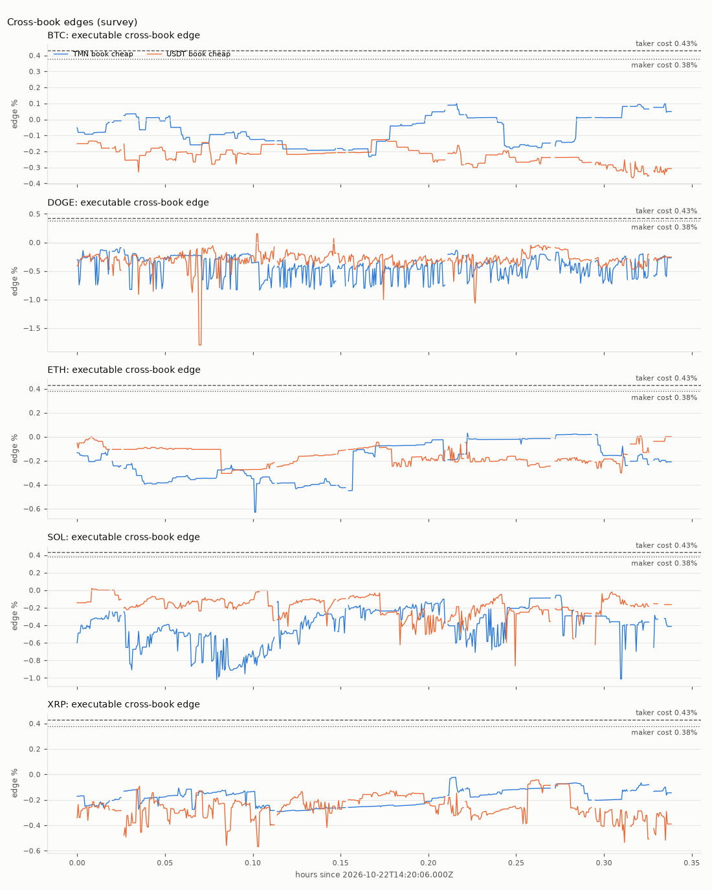

### 3. USDTTMN (the dollar)

Source: 1-minute candles from the store; 135 candles in the window, plus up to 25 h before it as history.

| Measure | n | Median | p90 |
|---|---:|---:|---:|
| 15-min ATR(14) % of close (engine `atr_15m_pct` at each 15-min step) | 0 | n/a | n/a |

| Return (close to close, every minute) | n | min | p5 | p25 | median | p75 | p95 | max |
|---|---:|---:|---:|---:|---:|---:|---:|---:|
| 1 h | 75 | 0.063% | 0.066% | 0.116% | 0.154% | 0.173% | 0.267% | 0.315% |
| 24 h | 0 | n/a | n/a | n/a | n/a | n/a | n/a | n/a |

| Rules regime (`rule_regime`) | 15-min steps | Share | Hours |
|---|---:|---:|---:|
| range | 0 | n/a | 0.00 |
| trend_up | 0 | n/a | 0.00 |
| trend_down | 0 | n/a | 0.00 |
| chaos | 0 | n/a | 0.00 |
| n/a (less than 24 h of candles before the step) | 288 | - | 72.00 |

Regime at each 15-minute step = `wta.strategies.s2_usdtalloc.rule_regime` over `wta.features.engine.candle_features` of the last 25 h of completed 1-minute candles — the S2 rules-only fallback exactly as the engine computes it. Shares exclude n/a steps.

### Method and limitations

- Edges are executable at the best level only, with fees from the offline fee snapshot. Slippage beyond the best level, latency between the two legs, partial fills and queue position are not modelled: real captured edges will be smaller.
- The recorder does not store identical consecutive snapshots, so a gap > 10 s can also be an unchanged book. The as-of join treats a book older than 10 s as missing (conservative: it lowers coverage and can only end opportunities early).
- Depth is limited to the stored levels (10 per side); a thin book may reach less than 0.3 % from mid.
- Candles carry no source tag: when the books are synthetic, the candles in the same store most likely are too.
- The maker-leg-1 variant only changes the fee (maker instead of taker on leg 1); it assumes leg 1 fills at the same executable price and does not model the chance that a resting order is not filled before the edge closes — hence the median-duration condition below.
- Per-day numbers are rates over the aligned hours of each coin; a short window extrapolates a few hours to a day.
- Recommendation rules: if the taker variant gives < 2/day at 0.15% (PRD-03 §3) the margin is 0.08%; otherwise the largest evaluated margin >= 0.15% with >= 3 taker opportunities/day (else 0.15%); leg1_taker=false only if the maker variant gives >= 1.5x the opportunities with a median duration > 20 s; lock-in viable = >= 3/day at a margin >= 0.10%; coins with less than 1 h of aligned data are left out.

---

## 3. Backtest: 1-min candles, 30 days, S2+S3 (SYNTHETIC)

_Source: [bt_candles_30d/report.md](../docs/REPORTS/bt_candles_30d/report.md) — Candle backtest, 30 days, S2+S3 (S3 rules-only), ai=off — SYNTHETIC, 2026-10-23._

> **SYNTHETIC DATA — not evidence of performance.** This run used generated market data (offline SyntheticFeed), not data recorded from Wallex. It proves the pipeline runs end to end; it proves nothing about returns.

| run | value |
| --- | --- |
| Config hash | `3ac4c2c08f98` |
| Git commit | `e25b87b5248b1dddc40353ec1816acab378685d8` |
| Mode | backtest |
| Driver | candles |
| Requested window (UTC) | 2026-10-01T00:00:00Z → 2026-10-31T00:00:00Z (720.0 h) |
| Data present (UTC) | 2026-10-01T00:00:00Z → 2026-10-31T00:00:00Z (720.0 h) |
| Data source | SYNTHETIC generated market DB synth_candles_30d.sqlite (seed 42, hours 720.0, step_s 10.0, volume_model clustered) (SYNTHETIC) |
| AI | off |
| Strategies | S2, S3 |
| Data end (UTC) | 2026-10-31T00:00:00Z |
| Report date | 2026-10-23 (commit date of e25b87b5248b + uncommitted changes) |
| ai_source | disabled |
| candles_ingested | 302,400 |
| coverage_hours | 720.00 |
| fee_budget_pct | 2.00% |
| fees_source | configs/fees_snapshot.yaml |
| flatten_at_end | yes |
| git_dirty | yes |
| initial_equity_tmn | 5,000,000 |
| market_db | synth_candles_30d.sqlite |
| seed | 42 |
| state_db | state_bt_candles_30d.sqlite |
| step_s | 1m 00s |
| synthetic_note | synthetic market data: an offline exercise of the engine, never evidence of performance |
| tick_crashes | 0 |
| ticks | 43,200 |
| warmup_candles | 0 |

### Metrics

| metric | value |
| --- | ---: |
| Initial equity (TMN) | 5,000,000 |
| Final equity (TMN) | 4,777,057 |
| PnL (TMN) | -222,943 |
| Return | -4.46% |
| Max drawdown (below running peak) | 5.20% |
| Longest drawdown | 29d 17h |
| Sharpe (annualized, from 1-h returns) | -7.81 |
| Sortino (annualized, from 1-h returns) | -9.85 |
| Closed trades / cycles | 3 |
| Winning trades | 1 |
| Losing trades | 2 |
| Win rate | 33.33% |
| Profit factor | 0.31 |
| Average PnL per trade | -0.68% |
| Average hold | 1h 31m |
| Gross profit (TMN) | 8,717 |
| Gross loss (TMN) | 28,380 |
| Closed trades PnL (TMN) | -19,663 |
| Orders placed | 68 |
| Risk vetoes | 79 |
| Repeated vetoes suppressed in the log | 0 |
| Fees paid (TMN) | 104,683 |
| Fees / initial equity | 2.09% |
| Turnover (TMN) | n/a |
| Days of data | 30.00 |
| Equity points | 43,200 |
| Hourly returns (Sharpe/Sortino sample) | 720 |

_Percentages are shown ×100; [summary.json](../docs/REPORTS/bt_candles_30d/summary.json) has every metric, including the nested breakdowns, with percentages as fractions (0.012 = 1.2%)._

Notes on the metrics:

- 30.0 days of data (720 hourly returns) — do not over-interpret
- Sources: fees from given.

#### End state: realized vs unrealized

| end of window | value |
| --- | ---: |
| TMN cash | 4,685,474 |
| USDT held (TMN value) | 1,122 |
| Coins held (TMN value) | 90,461 |
| Equity (TMN) | 4,777,057 |
| Realized PnL (TMN cash − initial equity) | -314,526 |
| Unrealized at the end (equity − TMN cash) | 91,583 |
| Unrealized share of equity | 1.92% |
| Flat (all TMN) | no |
| Source | valuation |

### Equity curve (TMN)

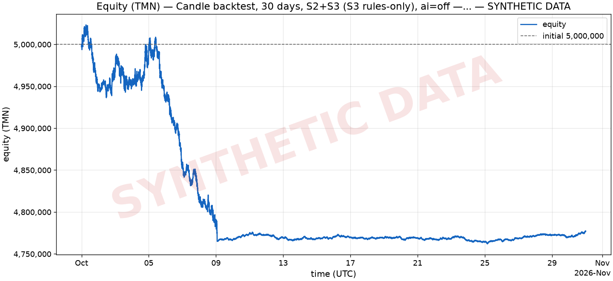

Data: [equity.csv](../docs/REPORTS/bt_candles_30d/equity.csv) (43,200 points).

### Drawdown

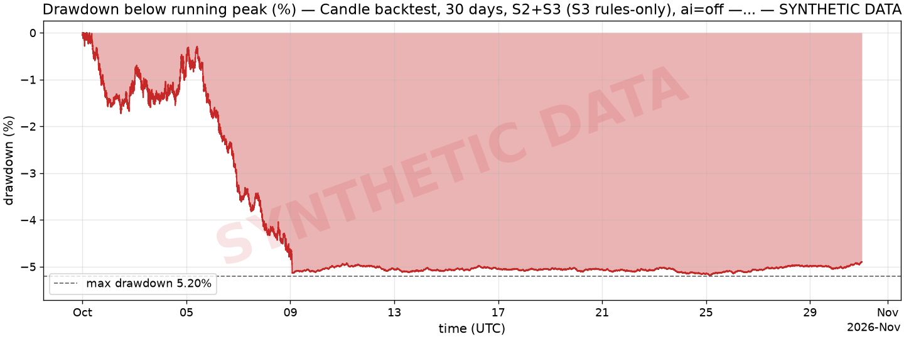

_Drawdown = (running peak − equity) / running peak; the initial equity is the first peak._

### Trades

Showing all 3 trades; full list (all columns): [trades.csv](../docs/REPORTS/bt_candles_30d/trades.csv).

| entry_ts | closed_ts | strategy | symbol | pnl_tmn | pnl_pct | fees_tmn | hold_s | exit_reason | position_id | decision_id |
| --- | --- | --- | --- | --- | --- | --- | --- | --- | --- | --- |
| 2026-10-03T12:32:00Z | 2026-10-03T13:46:00Z | S3 | SOLUSDT | 8,717 | 0.89% | 1,943 | 1h 14m | target | p_S3_SOLUSDT_1791030720000_1 | d_1791030660000_S3_SOLUSDT_1 |
| 2026-10-03T13:47:00Z | 2026-10-03T14:07:00Z | S3 | BTCUSDT | -13,359 | -1.37% | 2,207 | 20m 00s | stop | p_S3_BTCUSDT_1791035220000_2 | d_1791035160000_S3_BTCUSDT_2 |
| 2026-10-08T22:32:00Z | 2026-10-09T01:32:00Z | S3 | SOLUSDT | -15,021 | -1.57% | 2,140 | 3h 00m | stop | p_S3_SOLUSDT_1791498720000_3 | d_1791498660000_S3_SOLUSDT_1 |

Exit reasons: stop 2, target 1.

### Per strategy

| strategy | trades | wins | losses | win rate | PnL (TMN) | profit factor | avg PnL | avg hold | fees (TMN) | orders | vetoes |
| --- | ---: | ---: | ---: | ---: | ---: | ---: | ---: | ---: | ---: | ---: | ---: |
| FLATTEN | 0 | 0 | 0 | n/a | 0 | n/a | n/a | n/a | n/a | 1 | 0 |
| S2 | 0 | 0 | 0 | n/a | 0 | n/a | n/a | n/a | n/a | 57 | 76 |
| S3 | 3 | 1 | 2 | 33.33% | -19,663 | 0.31 | -0.68% | 1h 31m | 6,290 | 10 | 3 |

### Per day

| date (UTC) | start equity (TMN) | end equity (TMN) | return | trades | wins | trades PnL (TMN) | fees (TMN) | orders | vetoes |
| --- | ---: | ---: | ---: | ---: | ---: | ---: | ---: | ---: | ---: |
| 2026-10-01 | 5,000,000 | 4,951,181 | -0.98% | 0 | 0 | 0 | n/a | 3 | 0 |
| 2026-10-02 | 4,951,181 | 4,966,948 | 0.32% | 0 | 0 | 0 | n/a | 4 | 0 |
| 2026-10-03 | 4,966,948 | 4,953,129 | -0.28% | 2 | 1 | -4,641 | 4,151 | 10 | 0 |
| 2026-10-04 | 4,953,129 | 5,000,033 | 0.95% | 0 | 0 | 0 | n/a | 2 | 0 |
| 2026-10-05 | 5,000,033 | 4,937,048 | -1.26% | 0 | 0 | 0 | n/a | 12 | 0 |
| 2026-10-06 | 4,937,048 | 4,856,771 | -1.63% | 0 | 0 | 0 | n/a | 20 | 1 |
| 2026-10-07 | 4,856,771 | 4,814,421 | -0.87% | 0 | 0 | 0 | n/a | 4 | 1 |
| 2026-10-08 | 4,814,421 | 4,787,123 | -0.57% | 0 | 0 | 0 | n/a | 12 | 31 |
| 2026-10-09 | 4,787,123 | 4,766,620 | -0.43% | 1 | 0 | -15,021 | 2,140 | 1 | 46 |
| 2026-10-10 | 4,766,620 | 4,774,853 | 0.17% | 0 | 0 | 0 | n/a | 0 | 0 |
| 2026-10-11 | 4,774,853 | 4,773,013 | -0.04% | 0 | 0 | 0 | n/a | 0 | 0 |
| 2026-10-12 | 4,773,013 | 4,769,347 | -0.08% | 0 | 0 | 0 | n/a | 0 | 0 |
| 2026-10-13 | 4,769,347 | 4,767,360 | -0.04% | 0 | 0 | 0 | n/a | 0 | 0 |
| 2026-10-14 | 4,767,360 | 4,768,574 | 0.03% | 0 | 0 | 0 | n/a | 0 | 0 |
| 2026-10-15 | 4,768,574 | 4,770,119 | 0.03% | 0 | 0 | 0 | n/a | 0 | 0 |
| 2026-10-16 | 4,770,119 | 4,769,865 | -0.0053% | 0 | 0 | 0 | n/a | 0 | 0 |
| 2026-10-17 | 4,769,865 | 4,767,600 | -0.05% | 0 | 0 | 0 | n/a | 0 | 0 |
| 2026-10-18 | 4,767,600 | 4,768,630 | 0.02% | 0 | 0 | 0 | n/a | 0 | 0 |
| 2026-10-19 | 4,768,630 | 4,769,263 | 0.01% | 0 | 0 | 0 | n/a | 0 | 0 |
| 2026-10-20 | 4,769,263 | 4,769,154 | -0.0023% | 0 | 0 | 0 | n/a | 0 | 0 |
| 2026-10-21 | 4,769,154 | 4,767,429 | -0.04% | 0 | 0 | 0 | n/a | 0 | 0 |
| 2026-10-22 | 4,767,429 | 4,768,108 | 0.01% | 0 | 0 | 0 | n/a | 0 | 0 |
| 2026-10-23 | 4,768,108 | 4,765,955 | -0.05% | 0 | 0 | 0 | n/a | 0 | 0 |
| 2026-10-24 | 4,765,955 | 4,764,385 | -0.03% | 0 | 0 | 0 | n/a | 0 | 0 |
| 2026-10-25 | 4,764,385 | 4,765,964 | 0.03% | 0 | 0 | 0 | n/a | 0 | 0 |
| 2026-10-26 | 4,765,964 | 4,768,461 | 0.05% | 0 | 0 | 0 | n/a | 0 | 0 |
| 2026-10-27 | 4,768,461 | 4,771,353 | 0.06% | 0 | 0 | 0 | n/a | 0 | 0 |
| 2026-10-28 | 4,771,353 | 4,772,807 | 0.03% | 0 | 0 | 0 | n/a | 0 | 0 |
| 2026-10-29 | 4,772,807 | 4,770,811 | -0.04% | 0 | 0 | 0 | n/a | 0 | 0 |
| 2026-10-30 | 4,770,811 | 4,777,080 | 0.13% | 0 | 0 | 0 | n/a | 0 | 0 |
| 2026-10-31 | 4,777,080 | 4,777,057 | -0.0005% | 0 | 0 | 0 | n/a | 0 | 0 |

### Risk vetoes

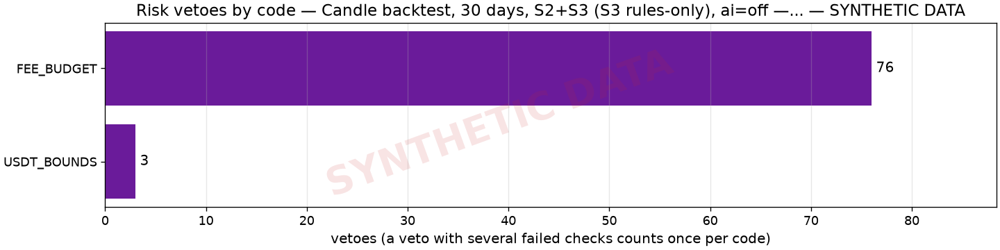

| risk code | vetoes | share |
| --- | ---: | ---: |
| FEE_BUDGET | 76 | 96.20% |
| USDT_BOUNDS | 3 | 3.80% |

Decision records (9 daily files, together the whole run: [decisions-20261001.jsonl](../docs/REPORTS/bt_candles_30d/decisions-20261001.jsonl), [decisions-20261002.jsonl](../docs/REPORTS/bt_candles_30d/decisions-20261002.jsonl), [decisions-20261003.jsonl](../docs/REPORTS/bt_candles_30d/decisions-20261003.jsonl), [decisions-20261004.jsonl](../docs/REPORTS/bt_candles_30d/decisions-20261004.jsonl), [decisions-20261005.jsonl](../docs/REPORTS/bt_candles_30d/decisions-20261005.jsonl), [decisions-20261006.jsonl](../docs/REPORTS/bt_candles_30d/decisions-20261006.jsonl), [decisions-20261007.jsonl](../docs/REPORTS/bt_candles_30d/decisions-20261007.jsonl), [decisions-20261008.jsonl](../docs/REPORTS/bt_candles_30d/decisions-20261008.jsonl), [decisions-20261009.jsonl](../docs/REPORTS/bt_candles_30d/decisions-20261009.jsonl); `decisions.jsonl` links only the newest day; orders and events are in the matching `orders-*` / `events-*` files): order 68, veto 79.

### AI (Regime Analyst)

AI was **off** in this run (rules-only defaults); no plans were produced.

| AI metric | value |
| --- | ---: |
| Plans produced | 0 |
| Average size multiplier | n/a |
| Plans that changed the enabled strategies | 0 |
| S3 entries gated by regime | 0 |
| Exits on a regime flip | 0 |

#### Ablation (ai=on vs ai=off)

_Ablation not available yet for this run._

### Fees vs budget

| fees | value |
| --- | ---: |
| Fees paid (TMN) | 104,683 |
| Initial equity (TMN) | 5,000,000 |
| Fee budget (2.00% of initial equity over the 72-h challenge, TMN) | 100,000 |
| Budget used | **104.68% (over budget)** |
| Fees per 72 h at this run's pace (720.00 h of data, TMN) | 10,468 |
| Budget used per 72 h at this pace | 10.47% |

### Limitations

Read these before reading any number above:

- SYNTHETIC — not evidence of performance: the market data was generated (seed 42, hours 720.0, step_s 10.0, volume_model clustered), not recorded from Wallex.
- Candle window = 720.0 h with 1-minute bars inside a requested window of 720.0 h; a minute without a candle inside a gap of at most 30 min is a flat bar at the previous close (the engine's CandleCache rule).
- No candles before the window: S2/S3 indicators warm up inside it (EMA60 of 15-minute bars needs 15 h, S3's breakout 21 bars).
- The challenge end was set to the window end: the deadline flatten ran in the last 2 h (no new entries there).
- S3 ran with allow_rules_only=true: without a fresh plan its regime gate is the rules regime of each symbol (S2's rule_regime), not an AI call.
- The drawdown kill-switch fired at 2026-10-09T01:39:00.000Z (drawdown_kill: drawdown 5.02% >= 5.00% from peak 5,023,241 TMN (equity 4,771,272 TMN)): the engine flattened to TMN and only monitored afterwards (manual reset only), so the rest of the window has no new trading.
- The fee budget (2.0% of initial equity, sized for the 72-h challenge) ran out: 76 entries were vetoed with FEE_BUDGET from 2026-10-08T23:01:00.000Z on.
- The data is synthetic (generated by the offline SyntheticFeed, not recorded from Wallex): the run exercises the code path end to end, but its returns, drawdowns and trade counts are not evidence of strategy performance.
- S1 not backtested on candles (candles carry no cross-book information); S1 evidence comes from the survey, the book-driven window and the live logs.
- Candle-driven fills use a synthetic book: mid = close, spread = the reference spread of configs/markets_snapshot.yaml for every symbol, unlimited depth at the best level; queue position and depth are not modelled.
- Fills come from the pessimistic candle fill model: an order acts one bar later; MARKET and crossing orders fill at close ± half the spread ± 0.02% slippage; the taker fee is paid on every fill of an order that crossed at placement (STOP orders always), the maker fee only by a LIMIT resting when placed; real queue position is not modelled.
- AI disabled (ai=off): rules-only defaults; the AI's contribution shows only in the ablation.
- 91,583 TMN was still held outside TMN (unrealized) at the end of the window although the deadline flatten ran (dust below a market's minimum order, or an exit still open); the challenge counts realized TMN only.

---

_Generated by `backtest/report.py`. Files: [summary.json](../docs/REPORTS/bt_candles_30d/summary.json), [trades.csv](../docs/REPORTS/bt_candles_30d/trades.csv), [equity.csv](../docs/REPORTS/bt_candles_30d/equity.csv)._

---

## 4. Backtest: 1-min candles, all recorded real candles (2.25 h), S2+S3

_Source: [bt_candles_recorded_ai_off/report.md](../docs/REPORTS/bt_candles_recorded_ai_off/report.md) — Candle backtest on ALL recorded real Wallex 1-min candles (2026-10-22 12:25-14:40Z), S2+S3 (S3 rules-only), ai=off, 2026-10-23._

| run | value |
| --- | --- |
| Config hash | `8fe0589adfb8` |
| Git commit | `e25b87b5248b1dddc40353ec1816acab378685d8` |
| Mode | backtest |
| Driver | candles |
| Requested window (UTC) | 2026-10-22T12:25:00Z → 2026-10-22T14:40:00Z (2.2 h) |
| Data present (UTC) | 2026-10-22T12:25:00Z → 2026-10-22T14:40:00Z (2.2 h) |
| Data source | recorded Wallex market data (wta.sqlite) |
| AI | off |
| Strategies | S2, S3 |
| Data end (UTC) | 2026-10-22T14:40:00Z |
| Report date | 2026-10-23 (commit date of e25b87b5248b + uncommitted changes) |
| ai_source | disabled |
| candles_ingested | 940 |
| coverage_hours | 2.25 |
| fee_budget_pct | 2.00% |
| fees_source | configs/fees_snapshot.yaml |
| flatten_at_end | no |
| git_dirty | yes |
| initial_equity_tmn | 5,000,000 |
| market_db | data/wta.sqlite |
| seed | 42 |
| state_db | state_bt_candles_recorded_ai_off.sqlite |
| step_s | 1m 00s |
| tick_crashes | 0 |
| ticks | 135 |
| warmup_candles | 0 |

### Metrics

| metric | value |
| --- | ---: |
| Initial equity (TMN) | 5,000,000 |
| Final equity (TMN) | 5,004,606 |
| PnL (TMN) | 4,606 |
| Return | 0.09% |
| Max drawdown (below running peak) | 0.09% |
| Longest drawdown | 1h 48m |
| Sharpe (annualized, from 1-h returns) | 36.74 |
| Sortino (annualized, from 1-h returns) | 243.46 |
| Closed trades / cycles | 0 |
| Winning trades | 0 |
| Losing trades | 0 |
| Win rate | n/a |
| Profit factor | n/a |
| Average PnL per trade | n/a |
| Average hold | n/a |
| Gross profit (TMN) | 0 |
| Gross loss (TMN) | 0 |
| Closed trades PnL (TMN) | 0 |
| Orders placed | 4 |
| Risk vetoes | 0 |
| Repeated vetoes suppressed in the log | 0 |
| Fees paid (TMN) | 6,242 |
| Fees / initial equity | 0.12% |
| Turnover (TMN) | n/a |
| Days of data | 0.09 |
| Equity points | 135 |
| Hourly returns (Sharpe/Sortino sample) | 3 |

_Percentages are shown ×100; [summary.json](../docs/REPORTS/bt_candles_recorded_ai_off/summary.json) has every metric, including the nested breakdowns, with percentages as fractions (0.012 = 1.2%)._

Notes on the metrics:

- 0.1 days of data (3 hourly returns) — do not over-interpret
- Sources: fees from given.

#### End state: realized vs unrealized

| end of window | value |
| --- | ---: |
| TMN cash | 2,503,136 |
| USDT held (TMN value) | 2,501,469 |
| Coins held (TMN value) | 0 |
| Equity (TMN) | 5,004,606 |
| Realized PnL (TMN cash − initial equity) | -2,496,864 |
| Unrealized at the end (equity − TMN cash) | 2,501,469 |
| Unrealized share of equity | 49.98% |
| Flat (all TMN) | no |
| Source | valuation |

### Equity curve (TMN)

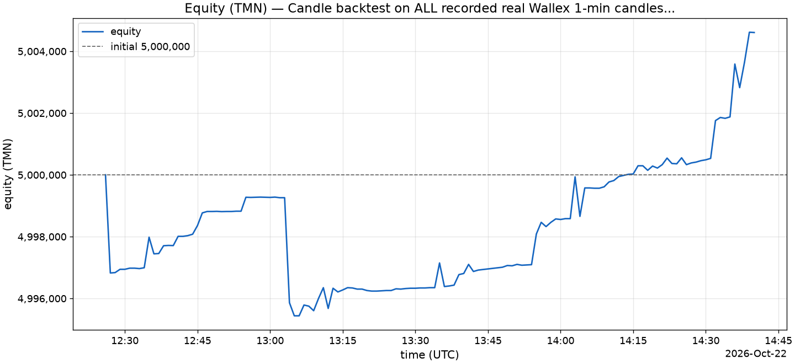

Data: [equity.csv](../docs/REPORTS/bt_candles_recorded_ai_off/equity.csv) (135 points).

### Drawdown

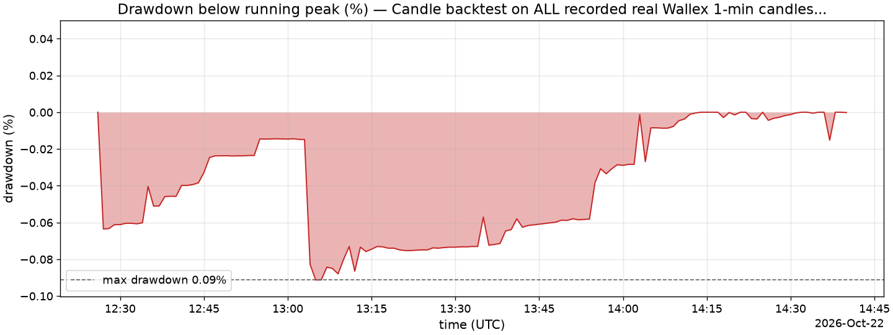

_Drawdown = (running peak − equity) / running peak; the initial equity is the first peak._

### Trades

_No trades in the window._ ([trades.csv](../docs/REPORTS/bt_candles_recorded_ai_off/trades.csv) has the header only.)

### Per strategy

| strategy | trades | wins | losses | win rate | PnL (TMN) | profit factor | avg PnL | avg hold | fees (TMN) | orders | vetoes |
| --- | ---: | ---: | ---: | ---: | ---: | ---: | ---: | ---: | ---: | ---: | ---: |
| S2 | 0 | 0 | 0 | n/a | 0 | n/a | n/a | n/a | n/a | 4 | 0 |

### Per day

| date (UTC) | start equity (TMN) | end equity (TMN) | return | trades | wins | trades PnL (TMN) | fees (TMN) | orders | vetoes |
| --- | ---: | ---: | ---: | ---: | ---: | ---: | ---: | ---: | ---: |
| 2026-10-22 | 5,000,000 | 5,004,606 | 0.09% | 0 | 0 | 0 | n/a | 4 | 0 |

### Risk vetoes


_No vetoes recorded._

Decision records ([decisions-20261022.jsonl](../docs/REPORTS/bt_candles_recorded_ai_off/decisions-20261022.jsonl)): order 4.

### AI (Regime Analyst)

AI was **off** in this run (rules-only defaults); no plans were produced.

| AI metric | value |
| --- | ---: |
| Plans produced | 0 |
| Average size multiplier | n/a |
| Plans that changed the enabled strategies | 0 |
| S3 entries gated by regime | 0 |
| Exits on a regime flip | 0 |

#### Ablation (ai=on vs ai=off)

_Ablation not available yet for this run._

### Fees vs budget

| fees | value |
| --- | ---: |
| Fees paid (TMN) | 6,242 |
| Initial equity (TMN) | 5,000,000 |
| Fee budget (2.00% of initial equity over the 72-h challenge, TMN) | 100,000 |
| Budget used | 6.24% |
| Fees per 72 h at this run's pace (2.25 h of data, TMN) | 199,740 |
| Budget used per 72 h at this pace | **199.74% (over budget)** |

### Limitations

Read these before reading any number above:

- Candle window = 2.2 h with 1-minute bars inside a requested window of 2.2 h; a minute without a candle inside a gap of at most 30 min is a flat bar at the previous close (the engine's CandleCache rule).
- No candles before the window: S2/S3 indicators warm up inside it (EMA60 of 15-minute bars needs 15 h, S3's breakout 21 bars).
- No end-of-window flatten: holdings at the end are valued at the bid (unrealized).
- S3 ran with allow_rules_only=true: without a fresh plan its regime gate is the rules regime of each symbol (S2's rule_regime), not an AI call.
- S1 not backtested on candles (candles carry no cross-book information); S1 evidence comes from the survey, the book-driven window and the live logs.
- Candle-driven fills use a synthetic book: mid = close, spread = the median spread of recorded books (3,705 books, 2026-10-22T14:20:05.929Z → 2026-10-22T14:39:59.737Z, none after the window end) for every symbol, unlimited depth at the best level; queue position and depth are not modelled.
- Fills come from the pessimistic candle fill model: an order acts one bar later; MARKET and crossing orders fill at close ± half the spread ± 0.02% slippage; the taker fee is paid on every fill of an order that crossed at placement (STOP orders always), the maker fee only by a LIMIT resting when placed; real queue position is not modelled.
- AI disabled (ai=off): rules-only defaults; the AI's contribution shows only in the ablation.
- Sharpe and Sortino are computed from 3 hourly returns over 2.2 h of data: reported, but not meaningful over so short a window.
- No closed trades in the window: win rate, profit factor and average PnL are undefined.
- 2,501,469 TMN was still held outside TMN (unrealized) at the end of the window; the challenge counts realized TMN only, so this run was not flattened.

---

_Generated by `backtest/report.py`. Files: [summary.json](../docs/REPORTS/bt_candles_recorded_ai_off/summary.json), [trades.csv](../docs/REPORTS/bt_candles_recorded_ai_off/trades.csv), [equity.csv](../docs/REPORTS/bt_candles_recorded_ai_off/equity.csv)._

---

## 5. Backtest: all recorded real order books (0.32 h), S1+S2, ai=off

_Source: [bt_books_recorded_ai_off/report.md](../docs/REPORTS/bt_books_recorded_ai_off/report.md) — Book backtest on ALL recorded real Wallex books (2026-10-22 14:20-20:17Z), S1+S2, ai=off, 2026-10-23._

| run | value |
| --- | --- |
| Config hash | `b942685638b5` |
| Git commit | `e25b87b5248b1dddc40353ec1816acab378685d8` |
| Mode | backtest |
| Driver | books |
| Requested window (UTC) | 2026-10-22T14:20:00Z → 2026-10-22T20:17:00Z (6.0 h) |
| Data present (UTC) | 2026-10-22T14:20:05.929Z → 2026-10-22T20:16:13.129Z (0.3 h) |
| Data source | recorded Wallex market data (wta.sqlite) |
| AI | off |
| Strategies | S1, S2 |
| Data end (UTC) | 2026-10-22T20:17:00Z |
| Report date | 2026-10-23 (commit date of e25b87b5248b + uncommitted changes) |
| ai_source | disabled |
| candles_ingested | 211 |
| coverage_hours | 0.32 |
| fee_budget_pct | 2.00% |
| fees_source | configs/fees_snapshot.yaml |
| flatten_at_end | no |
| git_dirty | yes |
| initial_equity_tmn | 5,000,000 |
| market_db | data/wta.sqlite |
| orders_stopped_by_gaps | 0 |
| s1_coverage_hours | 0.32 |
| seed | 42 |
| snapshots | 6,131 |
| state_db | state_bt_books_recorded_ai_off.sqlite |
| step_s | 2 s |
| tick_crashes | 0 |
| ticks | 583 |
| trades_published | 300 |
| warmup_candles | 1,265 |

### Metrics

| metric | value |
| --- | ---: |
| Initial equity (TMN) | 5,000,000 |
| Final equity (TMN) | 4,997,244 |
| PnL (TMN) | -2,756 |
| Return | -0.06% |
| Max drawdown (below running peak) | 0.06% |
| Longest drawdown | 5h 53m |
| Sharpe (annualized, from 1-h returns) | -52.14 |
| Sortino (annualized, from 1-h returns) | -48.25 |
| Closed trades / cycles | 0 |
| Winning trades | 0 |
| Losing trades | 0 |
| Win rate | n/a |
| Profit factor | n/a |
| Average PnL per trade | n/a |
| Average hold | n/a |
| Gross profit (TMN) | 0 |
| Gross loss (TMN) | 0 |
| Closed trades PnL (TMN) | 0 |
| Orders placed | 3 |
| Risk vetoes | 0 |
| Repeated vetoes suppressed in the log | 0 |
| Fees paid (TMN) | 3,123 |
| Fees / initial equity | 0.06% |
| Turnover (TMN) | n/a |
| Days of data | 0.25 |
| Equity points | 122 |
| Hourly returns (Sharpe/Sortino sample) | 7 |

_Percentages are shown ×100; [summary.json](../docs/REPORTS/bt_books_recorded_ai_off/summary.json) has every metric, including the nested breakdowns, with percentages as fractions (0.012 = 1.2%)._

Notes on the metrics:

- 0.2 days of data (7 hourly returns) — do not over-interpret
- Sources: fees from given.

#### End state: realized vs unrealized

| end of window | value |
| --- | ---: |
| TMN cash | 3,750,916 |
| USDT held (TMN value) | 1,246,328 |
| Coins held (TMN value) | 0 |
| Equity (TMN) | 4,997,244 |
| Realized PnL (TMN cash − initial equity) | -1,249,084 |
| Unrealized at the end (equity − TMN cash) | 1,246,328 |
| Unrealized share of equity | 24.94% |
| Flat (all TMN) | no |
| Source | valuation |

### Equity curve (TMN)


Data: [equity.csv](../docs/REPORTS/bt_books_recorded_ai_off/equity.csv) (122 points).

### Drawdown


_Drawdown = (running peak − equity) / running peak; the initial equity is the first peak._

### Trades

_No trades in the window._ ([trades.csv](../docs/REPORTS/bt_books_recorded_ai_off/trades.csv) has the header only.)

### Per strategy

| strategy | trades | wins | losses | win rate | PnL (TMN) | profit factor | avg PnL | avg hold | fees (TMN) | orders | vetoes |
| --- | ---: | ---: | ---: | ---: | ---: | ---: | ---: | ---: | ---: | ---: | ---: |
| S2 | 0 | 0 | 0 | n/a | 0 | n/a | n/a | n/a | n/a | 3 | 0 |

### Per day

| date (UTC) | start equity (TMN) | end equity (TMN) | return | trades | wins | trades PnL (TMN) | fees (TMN) | orders | vetoes |
| --- | ---: | ---: | ---: | ---: | ---: | ---: | ---: | ---: | ---: |
| 2026-10-22 | 5,000,000 | 4,997,244 | -0.06% | 0 | 0 | 0 | n/a | 3 | 0 |

### Risk vetoes


_No vetoes recorded._

Decision records ([decisions-20261022.jsonl](../docs/REPORTS/bt_books_recorded_ai_off/decisions-20261022.jsonl)): order 3.

### AI (Regime Analyst)

AI was **off** in this run (rules-only defaults); no plans were produced.

| AI metric | value |
| --- | ---: |
| Plans produced | 0 |
| Average size multiplier | n/a |
| Plans that changed the enabled strategies | 0 |
| S3 entries gated by regime | 0 |
| Exits on a regime flip | 0 |

#### Ablation (ai=on vs ai=off)

_ai=on (llm) run `bt_books_recorded_ai_on` vs ai=off run `bt_books_recorded_ai_off`: same window 2026-10-22T14:20:00.000Z → 2026-10-22T20:17:00.000Z, same market DB `data/wta.sqlite`, same seed and config apart from ai.enabled_

| metric | ai=off | ai=on | delta (on − off) |
| --- | ---: | ---: | ---: |
| return_pct | -0.06% | -0.06% | +0.00 pp |
| max_drawdown_pct | 0.06% | 0.06% | +0.00 pp |
| n_trades | 0 | 0 | +0 |
| n_orders | 3 | 3 | +0 |
| fees_paid_tmn | 3,123 | 3,123 | +0 |
| n_vetoes | 0 | 0 | +0 |

_Drawdowns are positive fractions: a positive max_drawdown_pct delta means the AI run drew down more._

### Fees vs budget

| fees | value |
| --- | ---: |
| Fees paid (TMN) | 3,123 |
| Initial equity (TMN) | 5,000,000 |
| Fee budget (2.00% of initial equity over the 72-h challenge, TMN) | 100,000 |
| Budget used | 3.12% |

### Limitations

Read these before reading any number above:

- Book window = 0.32 h of recorded data (583 ticks of 2 s with a snapshot, 6,131 snapshots) inside a requested window of 6.0 h; time without snapshots is skipped, not simulated.
- S1 cross-book coverage (USDTTMN and one coin's TMN and USDT books all fresh at once): 0.32 h.
- Indicator warm-up: 1,265 1-minute candles (1.9 h) from before the window were preloaded (the live engine loads up to 26 h at startup).
- No end-of-window flatten: holdings at the end are valued at the bid (unrealized).
- The requested window is 6.0 h but the data present covers only 0.3 h.
- S1 backtest window limited to recorded 0.3 h of order books.
- Fills come from the pessimistic book fill model: an order is matched only against a newer snapshot than the one it was placed on, and takes at most 80% of each level's quantity per snapshot, minus what our earlier fills took from that level while it is still shown (recorded snapshots do not reflect our fills); the taker fee is paid on every fill of an order that was crossing at placement (STOP_LIMIT: at its trigger), the maker fee only by a LIMIT resting when placed; real queue position is not modelled.
- AI disabled (ai=off): rules-only defaults; the AI's contribution shows only in the ablation.
- Sharpe and Sortino are computed from 7 hourly returns over 0.3 h of data: reported, but not meaningful over so short a window.
- No closed trades in the window: win rate, profit factor and average PnL are undefined.
- 1,246,328 TMN was still held outside TMN (unrealized) at the end of the window; the challenge counts realized TMN only, so this run was not flattened.

---

_Generated by `backtest/report.py`. Files: [summary.json](../docs/REPORTS/bt_books_recorded_ai_off/summary.json), [trades.csv](../docs/REPORTS/bt_books_recorded_ai_off/trades.csv), [equity.csv](../docs/REPORTS/bt_books_recorded_ai_off/equity.csv)._

---

## 6. Backtest: all recorded real order books (0.32 h), S1+S2, ai=on (real LLM)

_Source: [bt_books_recorded_ai_on/report.md](../docs/REPORTS/bt_books_recorded_ai_on/report.md) — Book backtest on ALL recorded real Wallex books (2026-10-22 14:20-20:17Z), S1+S2, ai=on (real LLM, cached), 2026-10-23._

| run | value |
| --- | --- |
| Config hash | `166f4e6e3833` |
| Git commit | `e25b87b5248b1dddc40353ec1816acab378685d8` |
| Mode | backtest |
| Driver | books |
| Requested window (UTC) | 2026-10-22T14:20:00Z → 2026-10-22T20:17:00Z (6.0 h) |
| Data present (UTC) | 2026-10-22T14:20:05.929Z → 2026-10-22T20:16:13.129Z (0.3 h) |
| Data source | recorded Wallex market data (wta.sqlite) |
| AI | on |
| Strategies | S1, S2 |
| Data end (UTC) | 2026-10-22T20:17:00Z |
| Report date | 2026-10-23 (commit date of e25b87b5248b + uncommitted changes) |
| ai_capped_at | n/a |
| ai_max_calls | 150 |
| ai_source | llm |
| analyst_cycles | 6 |
| analyst_failures | 0 |
| analyst_plans | 6 |
| cached_calls | 11 |
| candles_ingested | 211 |
| coverage_hours | 0.32 |
| fee_budget_pct | 2.00% |
| fees_source | configs/fees_snapshot.yaml |
| flatten_at_end | no |
| git_dirty | yes |
| initial_equity_tmn | 5,000,000 |
| llm_cache | docs/REPORTS/bt_books_recorded_ai_on/llm_cache |
| market_db | data/wta.sqlite |
| model_calls | 11 |
| orders_stopped_by_gaps | 0 |
| s1_coverage_hours | 0.32 |
| seed | 42 |
| snapshots | 6,131 |
| state_db | state_bt_books_recorded_ai_on.sqlite |
| step_s | 2 s |
| tick_crashes | 0 |
| ticks | 583 |
| trades_published | 300 |
| warmup_candles | 1,265 |

### Metrics

| metric | value |
| --- | ---: |
| Initial equity (TMN) | 5,000,000 |
| Final equity (TMN) | 4,997,244 |
| PnL (TMN) | -2,756 |
| Return | -0.06% |
| Max drawdown (below running peak) | 0.06% |
| Longest drawdown | 5h 53m |
| Sharpe (annualized, from 1-h returns) | -52.14 |
| Sortino (annualized, from 1-h returns) | -48.25 |
| Closed trades / cycles | 0 |
| Winning trades | 0 |
| Losing trades | 0 |
| Win rate | n/a |
| Profit factor | n/a |
| Average PnL per trade | n/a |
| Average hold | n/a |
| Gross profit (TMN) | 0 |
| Gross loss (TMN) | 0 |
| Closed trades PnL (TMN) | 0 |
| Orders placed | 3 |
| Risk vetoes | 0 |
| Repeated vetoes suppressed in the log | 0 |
| Fees paid (TMN) | 3,123 |
| Fees / initial equity | 0.06% |
| Turnover (TMN) | n/a |
| Days of data | 0.25 |
| Equity points | 122 |
| Hourly returns (Sharpe/Sortino sample) | 7 |

_Percentages are shown ×100; [summary.json](../docs/REPORTS/bt_books_recorded_ai_on/summary.json) has every metric, including the nested breakdowns, with percentages as fractions (0.012 = 1.2%)._

Notes on the metrics:

- 0.2 days of data (7 hourly returns) — do not over-interpret
- Sources: fees from given.

#### End state: realized vs unrealized

| end of window | value |
| --- | ---: |
| TMN cash | 3,750,916 |
| USDT held (TMN value) | 1,246,328 |
| Coins held (TMN value) | 0 |
| Equity (TMN) | 4,997,244 |
| Realized PnL (TMN cash − initial equity) | -1,249,084 |
| Unrealized at the end (equity − TMN cash) | 1,246,328 |
| Unrealized share of equity | 24.94% |
| Flat (all TMN) | no |
| Source | valuation |

### Equity curve (TMN)

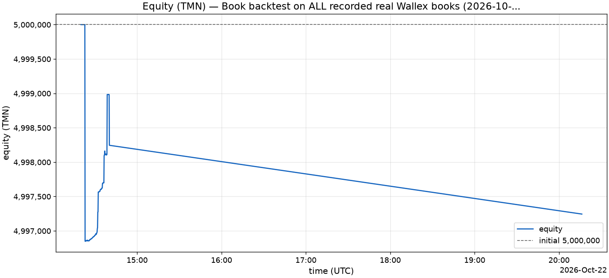

Data: [equity.csv](../docs/REPORTS/bt_books_recorded_ai_on/equity.csv) (122 points).

### Drawdown

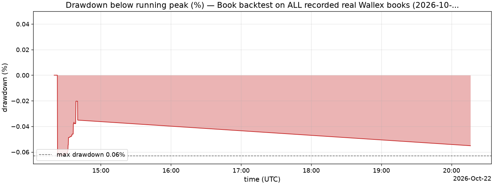

_Drawdown = (running peak − equity) / running peak; the initial equity is the first peak._

### Trades

_No trades in the window._ ([trades.csv](../docs/REPORTS/bt_books_recorded_ai_on/trades.csv) has the header only.)

### Per strategy

| strategy | trades | wins | losses | win rate | PnL (TMN) | profit factor | avg PnL | avg hold | fees (TMN) | orders | vetoes |
| --- | ---: | ---: | ---: | ---: | ---: | ---: | ---: | ---: | ---: | ---: | ---: |
| S2 | 0 | 0 | 0 | n/a | 0 | n/a | n/a | n/a | n/a | 3 | 0 |

### Per day

| date (UTC) | start equity (TMN) | end equity (TMN) | return | trades | wins | trades PnL (TMN) | fees (TMN) | orders | vetoes |
| --- | ---: | ---: | ---: | ---: | ---: | ---: | ---: | ---: | ---: |
| 2026-10-22 | 5,000,000 | 4,997,244 | -0.06% | 0 | 0 | 0 | n/a | 3 | 0 |

### Risk vetoes

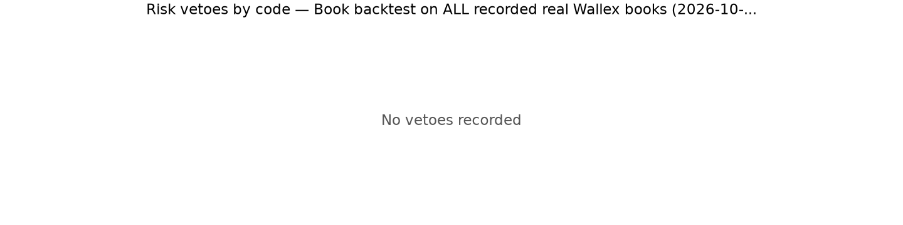

_No vetoes recorded._

Decision records ([decisions-20261022.jsonl](../docs/REPORTS/bt_books_recorded_ai_on/decisions-20261022.jsonl)): order 3, plan 6.

### AI (Regime Analyst)

| AI metric | value |
| --- | ---: |
| Plans produced | 6 |
| Average size multiplier | 0.86 |
| Plans that changed the enabled strategies | 0 |
| Plans served from the LLM cache | 6 |
| Plans with clamped fields | 0 |
| S3 entries gated by regime | 0 |
| Exits on a regime flip | 0 |
| Models | openai/gpt-5.4-mini |

Regime calls per symbol (count and share of that symbol's calls):

| symbol | trend_up | range | calls |
| --- | ---: | ---: | ---: |
| BTCUSDT | 0 (0.00%) | 6 (100.00%) | 6 |
| ETHUSDT | 0 (0.00%) | 6 (100.00%) | 6 |
| SOLUSDT | 0 (0.00%) | 6 (100.00%) | 6 |
| USDTTMN | 2 (33.33%) | 4 (66.67%) | 6 |

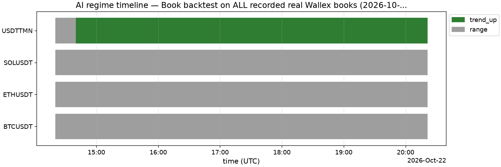

#### Ablation (ai=on vs ai=off)

_ai=on (llm) run `bt_books_recorded_ai_on` vs ai=off run `bt_books_recorded_ai_off`: same window 2026-10-22T14:20:00.000Z → 2026-10-22T20:17:00.000Z, same market DB `data/wta.sqlite`, same seed and config apart from ai.enabled_

| metric | ai=off | ai=on | delta (on − off) |
| --- | ---: | ---: | ---: |
| return_pct | -0.06% | -0.06% | +0.00 pp |
| max_drawdown_pct | 0.06% | 0.06% | +0.00 pp |
| n_trades | 0 | 0 | +0 |
| n_orders | 3 | 3 | +0 |
| fees_paid_tmn | 3,123 | 3,123 | +0 |
| n_vetoes | 0 | 0 | +0 |

_Drawdowns are positive fractions: a positive max_drawdown_pct delta means the AI run drew down more._

### Fees vs budget

| fees | value |
| --- | ---: |
| Fees paid (TMN) | 3,123 |
| Initial equity (TMN) | 5,000,000 |
| Fee budget (2.00% of initial equity over the 72-h challenge, TMN) | 100,000 |
| Budget used | 3.12% |

### Limitations

Read these before reading any number above:

- Book window = 0.32 h of recorded data (583 ticks of 2 s with a snapshot, 6,131 snapshots) inside a requested window of 6.0 h; time without snapshots is skipped, not simulated.
- S1 cross-book coverage (USDTTMN and one coin's TMN and USDT books all fresh at once): 0.32 h.
- Indicator warm-up: 1,265 1-minute candles (1.9 h) from before the window were preloaded (the live engine loads up to 26 h at startup).
- ai=on: the Regime Analyst ran at simulated times (cadence engine.slow_loop_interval_s = 300 s plus its event/move triggers), local tools only (MCP off), at most 150 cycles per run (6 run; the cap was not reached). Every answer is cached in llm_cache/, so a rerun reproduces the plans without network calls.
- The Post-trade Reviewer is not run in backtests: the config stays the same for the whole run.
- No end-of-window flatten: holdings at the end are valued at the bid (unrealized).
- LLM answers are model output: a different model or prompt version gives different plans.
- The requested window is 6.0 h but the data present covers only 0.3 h.
- S1 backtest window limited to recorded 0.3 h of order books.
- Fills come from the pessimistic book fill model: an order is matched only against a newer snapshot than the one it was placed on, and takes at most 80% of each level's quantity per snapshot, minus what our earlier fills took from that level while it is still shown (recorded snapshots do not reflect our fills); the taker fee is paid on every fill of an order that was crossing at placement (STOP_LIMIT: at its trigger), the maker fee only by a LIMIT resting when placed; real queue position is not modelled.
- Sharpe and Sortino are computed from 7 hourly returns over 0.3 h of data: reported, but not meaningful over so short a window.
- No closed trades in the window: win rate, profit factor and average PnL are undefined.
- 1,246,328 TMN was still held outside TMN (unrealized) at the end of the window; the challenge counts realized TMN only, so this run was not flattened.

---

_Generated by `backtest/report.py`. Files: [summary.json](../docs/REPORTS/bt_books_recorded_ai_on/summary.json), [trades.csv](../docs/REPORTS/bt_books_recorded_ai_on/trades.csv), [equity.csv](../docs/REPORTS/bt_books_recorded_ai_on/equity.csv)._

---

## 7. Backtest: 24 h order books, S1+S2, ai=off (SYNTHETIC)

_Source: [bt_books_synth24h_ai_off/report.md](../docs/REPORTS/bt_books_synth24h_ai_off/report.md) — Book backtest, 24 h, S1+S2, ai=off — SYNTHETIC, 2026-10-23._

> **SYNTHETIC DATA — not evidence of performance.** This run used generated market data (offline SyntheticFeed), not data recorded from Wallex. It proves the pipeline runs end to end; it proves nothing about returns.

| run | value |
| --- | --- |
| Config hash | `2aaaebec0508` |
| Git commit | `e25b87b5248b1dddc40353ec1816acab378685d8` |
| Mode | backtest |
| Driver | books |
| Requested window (UTC) | 2026-10-01T00:00:00Z → 2026-10-02T00:00:00Z (24.0 h) |
| Data present (UTC) | 2026-10-01T00:00:00Z → 2026-10-02T00:00:00Z (24.0 h) |
| Data source | SYNTHETIC generated market DB synth_books_24h.sqlite (seed 42, hours 24.0, step_s 2.0, volume_model feed) (SYNTHETIC) |
| AI | off |
| Strategies | S1, S2 |
| Data end (UTC) | 2026-10-02T00:00:00Z |
| Report date | 2026-10-23 (commit date of e25b87b5248b + uncommitted changes) |
| ai_source | disabled |
| candles_ingested | 10,080 |
| coverage_hours | 24.00 |
| fee_budget_pct | 2.00% |
| fees_source | configs/fees_snapshot.yaml |
| flatten_at_end | yes |
| git_dirty | yes |
| initial_equity_tmn | 5,000,000 |
| market_db | synth_books_24h.sqlite |
| orders_stopped_by_gaps | 0 |
| s1_coverage_hours | 24.00 |
| seed | 42 |
| snapshots | 302,407 |
| state_db | state_synth24h_ai_off.sqlite |
| step_s | 2 s |
| synthetic_note | synthetic market data: an offline exercise of the engine, never evidence of performance |
| tick_crashes | 0 |
| ticks | 43,201 |
| trades_published | 0 |
| warmup_candles | 0 |

### Metrics

| metric | value |
| --- | ---: |
| Initial equity (TMN) | 5,000,000 |
| Final equity (TMN) | 4,971,926 |
| PnL (TMN) | -28,074 |
| Return | -0.56% |
| Max drawdown (below running peak) | 0.90% |
| Longest drawdown | 22h 36m |
| Sharpe (annualized, from 1-h returns) | -16.18 |
| Sortino (annualized, from 1-h returns) | -18.86 |
| Closed trades / cycles | 4 |
| Winning trades | 0 |
| Losing trades | 4 |
| Win rate | 0.00% |
| Profit factor | 0.00 |
| Average PnL per trade | -0.23% |
| Average hold | 1m 35s |
| Gross profit (TMN) | 0 |
| Gross loss (TMN) | 9,126 |
| Closed trades PnL (TMN) | -9,126 |
| Orders placed | 43 |
| Risk vetoes | 38 |
| Repeated vetoes suppressed in the log | 0 |
| Fees paid (TMN) | 36,577 |
| Fees / initial equity | 0.73% |
| Turnover (TMN) | n/a |
| Days of data | 1.00 |
| Equity points | 8,641 |
| Hourly returns (Sharpe/Sortino sample) | 24 |

_Percentages are shown ×100; [summary.json](../docs/REPORTS/bt_books_synth24h_ai_off/summary.json) has every metric, including the nested breakdowns, with percentages as fractions (0.012 = 1.2%)._

Notes on the metrics:

- 1.0 days of data (24 hourly returns) — do not over-interpret
- Sources: fees from given.

#### End state: realized vs unrealized

| end of window | value |
| --- | ---: |
| TMN cash | 4,948,415 |
| USDT held (TMN value) | 1,857 |
| Coins held (TMN value) | 21,654 |
| Equity (TMN) | 4,971,926 |
| Realized PnL (TMN cash − initial equity) | -51,585 |
| Unrealized at the end (equity − TMN cash) | 23,511 |
| Unrealized share of equity | 0.47% |
| Flat (all TMN) | no |
| Source | valuation |

### Equity curve (TMN)

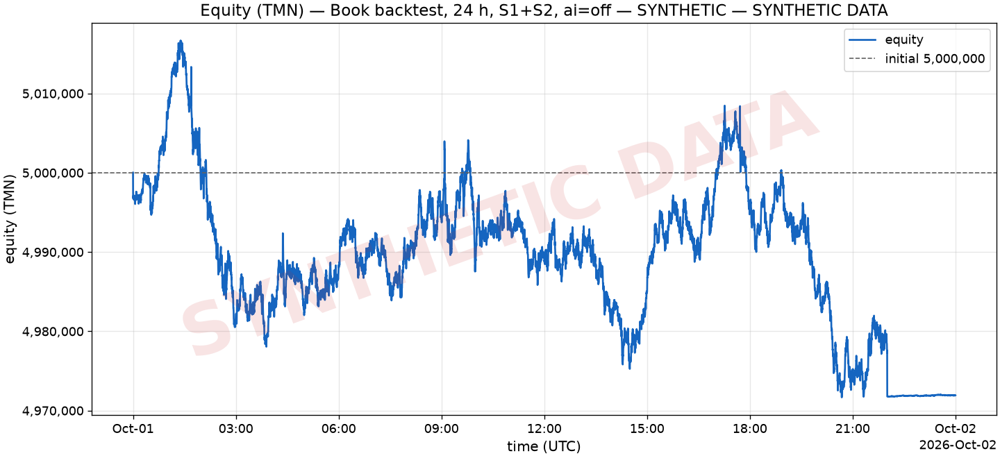

Data: [equity.csv](../docs/REPORTS/bt_books_synth24h_ai_off/equity.csv) (8,641 points).

### Drawdown

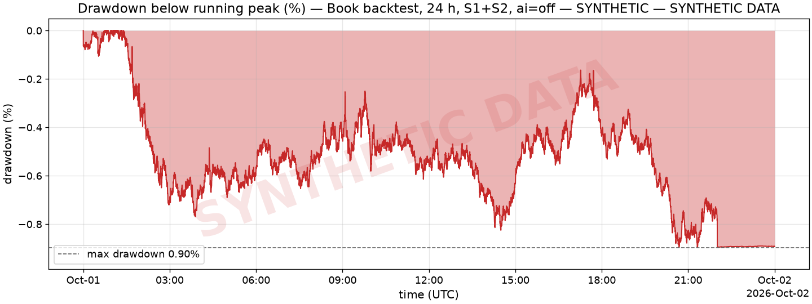

_Drawdown = (running peak − equity) / running peak; the initial equity is the first peak._

### Trades

Showing all 4 trades; full list (all columns): [trades.csv](../docs/REPORTS/bt_books_synth24h_ai_off/trades.csv).

| entry_ts | closed_ts | strategy | symbol | pnl_tmn | pnl_pct | fees_tmn | hold_s | exit_reason | position_id | decision_id |
| --- | --- | --- | --- | --- | --- | --- | --- | --- | --- | --- |
| 2026-10-01T01:41:50Z | 2026-10-01T01:43:38Z | S1 | ETHUSDT | -1,359 | -0.14% | 2,294 | 1m 48s | target | p_S1_ETHUSDT_1790818910000_1 | d_1790818908000_S1_ETHUSDT_1 |
| 2026-10-01T04:22:12Z | 2026-10-01T04:24:08Z | S1 | ETHUSDT | -3,343 | -0.34% | 2,583 | 1m 56s | target | p_S1_ETHUSDT_1790828532000_2 | d_1790828522000_S1_ETHUSDT_1 |
| 2026-10-01T09:05:12Z | 2026-10-01T09:07:10Z | S1 | ETHUSDT | -2,470 | -0.25% | 2,596 | 1m 58s | target | p_S1_ETHUSDT_1790845512000_3 | d_1790845510000_S1_ETHUSDT_1 |
| 2026-10-01T17:42:46Z | 2026-10-01T17:43:24Z | S1 | ETHUSDT | -1,953 | -0.20% | 4,277 | 38 s | lockin | p_S1_ETHUSDT_1790876566000_4 | d_1790876564000_S1_ETHUSDT_1 |

Exit reasons: target 3, lockin 1.

### Per strategy

| strategy | trades | wins | losses | win rate | PnL (TMN) | profit factor | avg PnL | avg hold | fees (TMN) | orders | vetoes |
| --- | ---: | ---: | ---: | ---: | ---: | ---: | ---: | ---: | ---: | ---: | ---: |
| FLATTEN | 0 | 0 | 0 | n/a | 0 | n/a | n/a | n/a | n/a | 1 | 0 |
| S1 | 4 | 0 | 4 | 0.00% | -9,126 | 0.00 | -0.23% | 1m 35s | 11,749 | 34 | 8 |
| S2 | 0 | 0 | 0 | n/a | 0 | n/a | n/a | n/a | n/a | 8 | 30 |

### Per day

| date (UTC) | start equity (TMN) | end equity (TMN) | return | trades | wins | trades PnL (TMN) | fees (TMN) | orders | vetoes |
| --- | ---: | ---: | ---: | ---: | ---: | ---: | ---: | ---: | ---: |
| 2026-10-01 | 5,000,000 | 4,971,946 | -0.56% | 4 | 0 | -9,126 | 11,749 | 43 | 38 |
| 2026-10-02 | 4,971,946 | 4,971,926 | -0.0004% | 0 | 0 | 0 | n/a | 0 | 0 |

### Risk vetoes

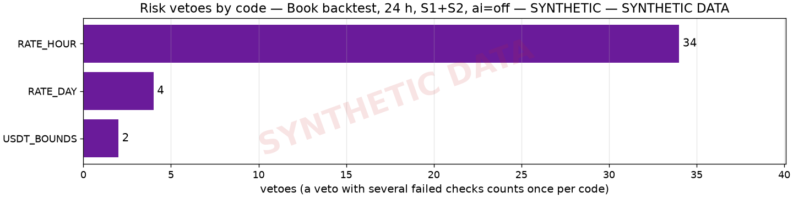

| risk code | vetoes | share |
| --- | ---: | ---: |
| RATE_HOUR | 34 | 85.00% |
| RATE_DAY | 4 | 10.00% |
| USDT_BOUNDS | 2 | 5.00% |

Decision records ([decisions-20261001.jsonl](../docs/REPORTS/bt_books_synth24h_ai_off/decisions-20261001.jsonl)): order 43, veto 38.

### AI (Regime Analyst)

AI was **off** in this run (rules-only defaults); no plans were produced.

| AI metric | value |
| --- | ---: |
| Plans produced | 0 |
| Average size multiplier | n/a |
| Plans that changed the enabled strategies | 0 |
| S3 entries gated by regime | 0 |
| Exits on a regime flip | 0 |

#### Ablation (ai=on vs ai=off)

_ai=offline (offline-rules) run `bt_books_synth24h_ai_offline` vs ai=off run `bt_books_synth24h_ai_off`: same window 2026-10-01T00:00:00.000Z → 2026-10-02T00:00:00.000Z, same market DB `synth_books_24h.sqlite`, same seed and config apart from ai.enabled_

| metric | ai=off | ai=on | delta (on − off) |
| --- | ---: | ---: | ---: |
| return_pct | -0.56% | -0.56% | +0.00 pp |
| max_drawdown_pct | 0.90% | 0.90% | +0.00 pp |
| n_trades | 4 | 4 | +0 |
| n_orders | 43 | 43 | +0 |
| fees_paid_tmn | 36,577 | 36,577 | +0 |
| n_vetoes | 38 | 38 | +0 |
| vetoes_by_code.RATE_DAY | 4 | 4 | +0 |
| vetoes_by_code.RATE_HOUR | 34 | 34 | +0 |
| vetoes_by_code.USDT_BOUNDS | 2 | 2 | +0 |

_Drawdowns are positive fractions: a positive max_drawdown_pct delta means the AI run drew down more._

### Fees vs budget

| fees | value |
| --- | ---: |
| Fees paid (TMN) | 36,577 |
| Initial equity (TMN) | 5,000,000 |
| Fee budget (2.00% of initial equity over the 72-h challenge, TMN) | 100,000 |
| Budget used | 36.58% |
| Fees per 72 h at this run's pace (24.00 h of data, TMN) | 109,728 |
| Budget used per 72 h at this pace | **109.73% (over budget)** |

### Limitations

Read these before reading any number above:

- SYNTHETIC — not evidence of performance: the market data was generated (seed 42, hours 24.0, step_s 2.0, volume_model feed), not recorded from Wallex.
- Book window = 24.00 h of generated (synthetic) data (43,201 ticks of 2 s with a snapshot, 302,407 snapshots) inside a requested window of 24.0 h; time without snapshots is skipped, not simulated.
- S1 cross-book coverage (USDTTMN and one coin's TMN and USDT books all fresh at once): 24.00 h.
- No data in the window for: ADATMN, ADAUSDT, AVAXTMN, AVAXUSDT, DOGETMN, DOGEUSDT, LINKTMN, LINKUSDT, LTCTMN, LTCUSDT, TRXTMN, TRXUSDT, XRPTMN, XRPUSDT (left out of the watchlist).
- No candles before the window: S2/S3 indicators warm up inside it (EMA60 of 15-minute bars needs 15 h, S3's breakout 21 bars).
- The challenge end was set to the window end: the deadline flatten ran in the last 2 h (no new entries there).
- The data is synthetic (generated by the offline SyntheticFeed, not recorded from Wallex): the run exercises the code path end to end, but its returns, drawdowns and trade counts are not evidence of strategy performance.
- S1 backtest window limited to generated (synthetic) 24.0 h of order books.
- Fills come from the pessimistic book fill model: an order is matched only against a newer snapshot than the one it was placed on, and takes at most 80% of each level's quantity per snapshot, minus what our earlier fills took from that level while it is still shown (recorded snapshots do not reflect our fills); the taker fee is paid on every fill of an order that was crossing at placement (STOP_LIMIT: at its trigger), the maker fee only by a LIMIT resting when placed; real queue position is not modelled.
- AI disabled (ai=off): rules-only defaults; the AI's contribution shows only in the ablation.
- Sharpe and Sortino are computed from 24 hourly returns over 24 h of data: reported, but not meaningful over so short a window.
- 23,511 TMN was still held outside TMN (unrealized) at the end of the window although the deadline flatten ran (dust below a market's minimum order, or an exit still open); the challenge counts realized TMN only.

---

_Generated by `backtest/report.py`. Files: [summary.json](../docs/REPORTS/bt_books_synth24h_ai_off/summary.json), [trades.csv](../docs/REPORTS/bt_books_synth24h_ai_off/trades.csv), [equity.csv](../docs/REPORTS/bt_books_synth24h_ai_off/equity.csv)._

---

## 8. Backtest: 6 h order books, S1+S2, ai=on with the real LLM (SYNTHETIC)

_Source: [bt_books_synth24h_6h_ai_on/report.md](../docs/REPORTS/bt_books_synth24h_6h_ai_on/report.md) — Book backtest, 6 h sub-window 12:00-18:00Z, S1+S2, ai=on (real LLM, cached) — SYNTHETIC, 2026-10-23._

> **SYNTHETIC DATA — not evidence of performance.** This run used generated market data (offline SyntheticFeed), not data recorded from Wallex. It proves the pipeline runs end to end; it proves nothing about returns.

| run | value |
| --- | --- |
| Config hash | `37bf18e4ba22` |
| Git commit | `e25b87b5248b1dddc40353ec1816acab378685d8` |
| Mode | backtest |
| Driver | books |
| Requested window (UTC) | 2026-10-01T12:00:00Z → 2026-10-01T18:00:00Z (6.0 h) |
| Data present (UTC) | 2026-10-01T12:00:00Z → 2026-10-01T18:00:00Z (6.0 h) |
| Data source | SYNTHETIC generated market DB synth_books_24h.sqlite (seed 42, hours 24.0, step_s 2.0, volume_model feed) (SYNTHETIC) |
| AI | on |
| Strategies | S1, S2 |
| Data end (UTC) | 2026-10-01T18:00:00Z |
| Report date | 2026-10-23 (commit date of e25b87b5248b + uncommitted changes) |
| ai_capped_at | n/a |
| ai_max_calls | 150 |
| ai_source | llm |
| analyst_cycles | 73 |
| analyst_failures | 0 |
| analyst_plans | 73 |
| cached_calls | 132 |
| candles_ingested | 2,527 |
| coverage_hours | 6.00 |
| fee_budget_pct | 2.00% |
| fees_source | configs/fees_snapshot.yaml |
| flatten_at_end | no |
| git_dirty | yes |
| initial_equity_tmn | 5,000,000 |
| llm_cache | docs/REPORTS/bt_books_synth24h_6h_ai_on/llm_cache |
| market_db | synth_books_24h.sqlite |
| model_calls | 132 |
| orders_stopped_by_gaps | 0 |
| s1_coverage_hours | 6.00 |
| seed | 42 |
| snapshots | 75,607 |
| state_db | state_synth24h_6h_ai_on.sqlite |
| step_s | 2 s |
| synthetic_note | synthetic market data: an offline exercise of the engine, never evidence of performance |
| tick_crashes | 0 |
| ticks | 10,801 |
| trades_published | 0 |
| warmup_candles | 5,033 |

### Metrics

| metric | value |
| --- | ---: |
| Initial equity (TMN) | 5,000,000 |
| Final equity (TMN) | 5,006,035 |
| PnL (TMN) | 6,035 |
| Return | 0.12% |
| Max drawdown (below running peak) | 0.38% |
| Longest drawdown | 3h 22m |
| Sharpe (annualized, from 1-h returns) | 14.94 |
| Sortino (annualized, from 1-h returns) | 24.73 |
| Closed trades / cycles | 0 |
| Winning trades | 0 |
| Losing trades | 0 |
| Win rate | n/a |
| Profit factor | n/a |
| Average PnL per trade | n/a |
| Average hold | n/a |
| Gross profit (TMN) | 0 |
| Gross loss (TMN) | 0 |
| Closed trades PnL (TMN) | 0 |
| Orders placed | 6 |
| Risk vetoes | 0 |
| Repeated vetoes suppressed in the log | 0 |
| Fees paid (TMN) | 6,234 |
| Fees / initial equity | 0.12% |
| Turnover (TMN) | n/a |
| Days of data | 0.25 |
| Equity points | 2,161 |
| Hourly returns (Sharpe/Sortino sample) | 6 |

_Percentages are shown ×100; [summary.json](../docs/REPORTS/bt_books_synth24h_6h_ai_on/summary.json) has every metric, including the nested breakdowns, with percentages as fractions (0.012 = 1.2%)._

Notes on the metrics:

- 0.2 days of data (6 hourly returns) — do not over-interpret
- Sources: fees from given.

#### End state: realized vs unrealized

| end of window | value |
| --- | ---: |
| TMN cash | 2,506,162 |
| USDT held (TMN value) | 2,499,873 |
| Coins held (TMN value) | 0 |
| Equity (TMN) | 5,006,035 |
| Realized PnL (TMN cash − initial equity) | -2,493,838 |
| Unrealized at the end (equity − TMN cash) | 2,499,873 |
| Unrealized share of equity | 49.94% |
| Flat (all TMN) | no |
| Source | valuation |

### Equity curve (TMN)

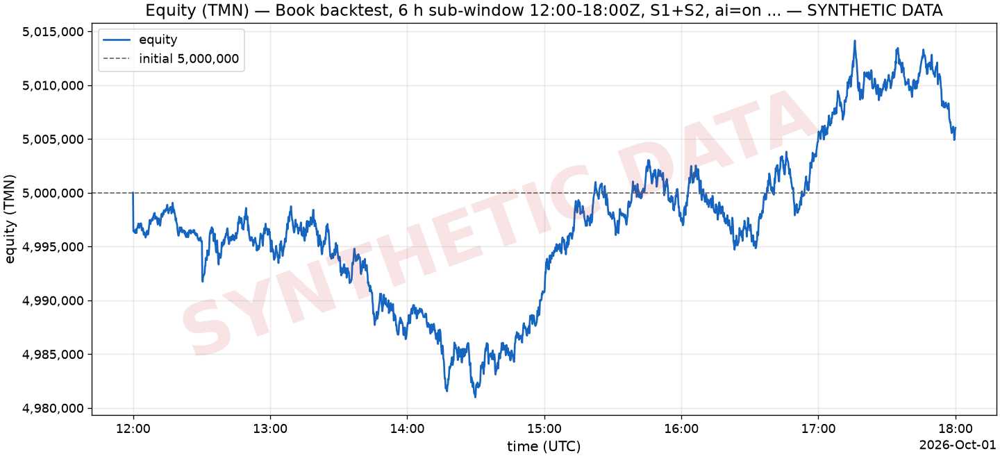

Data: [equity.csv](../docs/REPORTS/bt_books_synth24h_6h_ai_on/equity.csv) (2,161 points).

### Drawdown

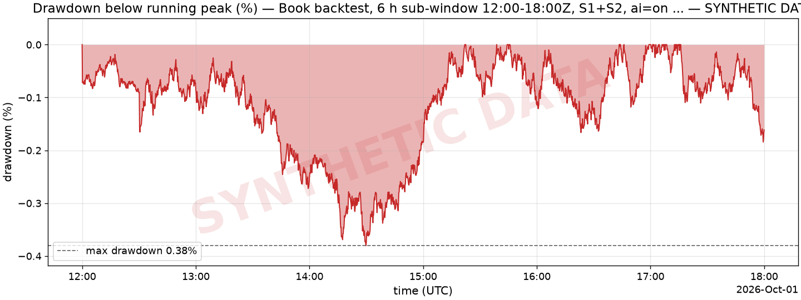

_Drawdown = (running peak − equity) / running peak; the initial equity is the first peak._

### Trades

_No trades in the window._ ([trades.csv](../docs/REPORTS/bt_books_synth24h_6h_ai_on/trades.csv) has the header only.)

### Per strategy

| strategy | trades | wins | losses | win rate | PnL (TMN) | profit factor | avg PnL | avg hold | fees (TMN) | orders | vetoes |
| --- | ---: | ---: | ---: | ---: | ---: | ---: | ---: | ---: | ---: | ---: | ---: |
| S1 | 0 | 0 | 0 | n/a | 0 | n/a | n/a | n/a | n/a | 4 | 0 |
| S2 | 0 | 0 | 0 | n/a | 0 | n/a | n/a | n/a | n/a | 2 | 0 |

### Per day

| date (UTC) | start equity (TMN) | end equity (TMN) | return | trades | wins | trades PnL (TMN) | fees (TMN) | orders | vetoes |
| --- | ---: | ---: | ---: | ---: | ---: | ---: | ---: | ---: | ---: |
| 2026-10-01 | 5,000,000 | 5,006,035 | 0.12% | 0 | 0 | 0 | n/a | 6 | 0 |

### Risk vetoes

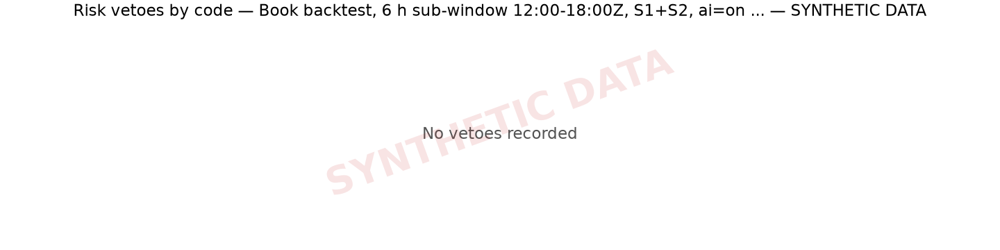

_No vetoes recorded._

Decision records ([decisions-20261001.jsonl](../docs/REPORTS/bt_books_synth24h_6h_ai_on/decisions-20261001.jsonl)): order 6, plan 73.

### AI (Regime Analyst)

| AI metric | value |
| --- | ---: |
| Plans produced | 73 |
| Average size multiplier | 0.87 |
| Plans that changed the enabled strategies | 0 |
| Plans served from the LLM cache | 73 |
| Plans with clamped fields | 0 |
| S3 entries gated by regime | 0 |
| Exits on a regime flip | 0 |
| Models | openai/gpt-5.4-mini |

Regime calls per symbol (count and share of that symbol's calls):

| symbol | trend_up | range | trend_down | calls |
| --- | ---: | ---: | ---: | ---: |
| BTCUSDT | 14 (19.18%) | 54 (73.97%) | 5 (6.85%) | 73 |
| ETHUSDT | 17 (23.29%) | 51 (69.86%) | 5 (6.85%) | 73 |
| SOLUSDT | 28 (38.36%) | 33 (45.21%) | 12 (16.44%) | 73 |
| USDTTMN | 5 (6.85%) | 68 (93.15%) | 0 (0.00%) | 73 |

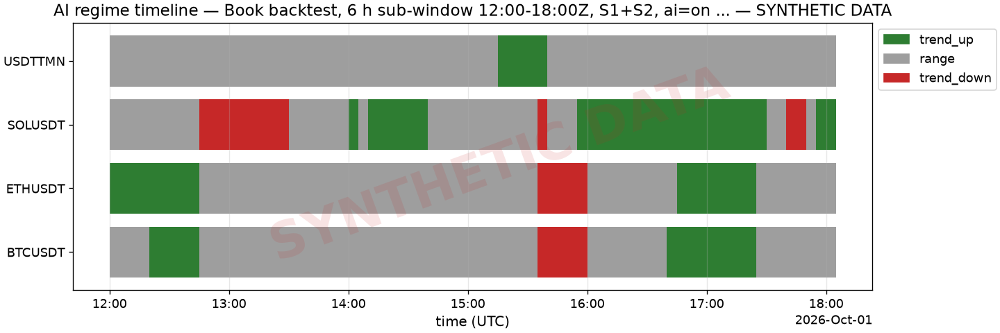

#### Ablation (ai=on vs ai=off)

_ai=on (llm) run `bt_books_synth24h_6h_ai_on` vs ai=off run `bt_books_synth24h_6h_ai_off`: same window 2026-10-01T12:00:00.000Z → 2026-10-01T18:00:00.000Z, same market DB `synth_books_24h.sqlite`, same seed and config apart from ai.enabled_

| metric | ai=off | ai=on | delta (on − off) |
| --- | ---: | ---: | ---: |
| return_pct | 0.03% | 0.12% | +0.09 pp |
| max_drawdown_pct | 0.38% | 0.38% | +0.00 pp |
| n_trades | 1 | 0 | -1 |
| n_orders | 12 | 6 | -6 |
| fees_paid_tmn | 13,006 | 6,234 | -6,772 |
| n_vetoes | 0 | 0 | +0 |

_Drawdowns are positive fractions: a positive max_drawdown_pct delta means the AI run drew down more._

### Fees vs budget

| fees | value |
| --- | ---: |
| Fees paid (TMN) | 6,234 |
| Initial equity (TMN) | 5,000,000 |
| Fee budget (2.00% of initial equity over the 72-h challenge, TMN) | 100,000 |
| Budget used | 6.23% |
| Fees per 72 h at this run's pace (6.00 h of data, TMN) | 74,795 |
| Budget used per 72 h at this pace | 74.80% |

### Limitations

Read these before reading any number above:

- SYNTHETIC — not evidence of performance: the market data was generated (seed 42, hours 24.0, step_s 2.0, volume_model feed), not recorded from Wallex.
- Book window = 6.00 h of generated (synthetic) data (10,801 ticks of 2 s with a snapshot, 75,607 snapshots) inside a requested window of 6.0 h; time without snapshots is skipped, not simulated.
- S1 cross-book coverage (USDTTMN and one coin's TMN and USDT books all fresh at once): 6.00 h.
- No data in the window for: ADATMN, ADAUSDT, AVAXTMN, AVAXUSDT, DOGETMN, DOGEUSDT, LINKTMN, LINKUSDT, LTCTMN, LTCUSDT, TRXTMN, TRXUSDT, XRPTMN, XRPUSDT (left out of the watchlist).
- Indicator warm-up: 5,033 1-minute candles (12.0 h) from before the window were preloaded (the live engine loads up to 26 h at startup).
- ai=on: the Regime Analyst ran at simulated times (cadence engine.slow_loop_interval_s = 300 s plus its event/move triggers), local tools only (MCP off), at most 150 cycles per run (73 run; the cap was not reached). Every answer is cached in llm_cache/, so a rerun reproduces the plans without network calls.
- The Post-trade Reviewer is not run in backtests: the config stays the same for the whole run.
- No end-of-window flatten: holdings at the end are valued at the bid (unrealized).
- LLM answers are model output: a different model or prompt version gives different plans.
- The data is synthetic (generated by the offline SyntheticFeed, not recorded from Wallex): the run exercises the code path end to end, but its returns, drawdowns and trade counts are not evidence of strategy performance.
- S1 backtest window limited to generated (synthetic) 6.0 h of order books.
- Fills come from the pessimistic book fill model: an order is matched only against a newer snapshot than the one it was placed on, and takes at most 80% of each level's quantity per snapshot, minus what our earlier fills took from that level while it is still shown (recorded snapshots do not reflect our fills); the taker fee is paid on every fill of an order that was crossing at placement (STOP_LIMIT: at its trigger), the maker fee only by a LIMIT resting when placed; real queue position is not modelled.
- Sharpe and Sortino are computed from 6 hourly returns over 6.0 h of data: reported, but not meaningful over so short a window.
- No closed trades in the window: win rate, profit factor and average PnL are undefined.
- 2,499,873 TMN was still held outside TMN (unrealized) at the end of the window; the challenge counts realized TMN only, so this run was not flattened.

---

_Generated by `backtest/report.py`. Files: [summary.json](../docs/REPORTS/bt_books_synth24h_6h_ai_on/summary.json), [trades.csv](../docs/REPORTS/bt_books_synth24h_6h_ai_on/trades.csv), [equity.csv](../docs/REPORTS/bt_books_synth24h_6h_ai_on/equity.csv)._

---

## 9. AI ablation (ai=on − ai=off)

_Source: [ablation_20261023.md](../docs/REPORTS/ablation_20261023.md) — AI ablation (ai=on − ai=off), 2026-10-23._

> **SYNTHETIC DATA — not evidence of performance** in sections 2 and 3. Section 1 uses recorded Wallex books, but only 0.32 h of them.

Three pairs of backtests: the same window, market DB, seed and config, apart from `ai.enabled`. The first pair runs on
**recorded Wallex order books**, but they cover only 0.32 h. The other two pairs run on **SYNTHETIC DATA — not
evidence of performance**. Each run folder has its full report, and its ablation table is also in the "AI" section of
both reports.

The tables are made by `backtest.metrics.ablation_delta` from the two `summary.json` files (the command is in
`phase5_acceptance.md` §2.3). In the third table the "ai=on" column is the `ai=offline` run. All six runs were
rerun after the review fixes of `phase5_acceptance.md` §8 (book fill model: taker fee for every fill of an order that
crossed at placement, the 80 % level cap carried across snapshots, no fill across a recording gap); the ai=on reruns
were served entirely from their caches (11/11 and 132/132 calls cached, no provider call).

**Bottom line.**
* On real data the LLM changed **nothing**: 0 trades either way.
* On synthetic data it helped by **+0.09 pp** in a single 6-h window, by skipping two marginal S1 signals.
* The offline rules provider reproduces rules-only exactly, by design.

None of this is evidence that the AI adds return: the real window is 20 minutes of data, and the rest is generated.

### 1. Recorded real books, 2026-10-22 14:20–20:17Z (0.32 h of data), S1+S2

Runs:
* [`bt_books_recorded_ai_on`](../docs/REPORTS/bt_books_recorded_ai_on/report.md): real OpenRouter `openai/gpt-5.4-mini`, 6 analyst cycles, 11 model calls, cached.
* [`bt_books_recorded_ai_off`](../docs/REPORTS/bt_books_recorded_ai_off/report.md).

| metric | ai=off | ai=on | delta (on − off) |
| --- | ---: | ---: | ---: |
| return_pct | -0.06% | -0.06% | +0.00 pp |
| max_drawdown_pct | 0.06% | 0.06% | +0.00 pp |
| n_trades | 0 | 0 | +0 |
| n_orders | 3 | 3 | +0 |
| fees_paid_tmn | 3,123 | 3,123 | +0 |
| n_vetoes | 0 | 0 | +0 |

The plans did not change a single order. Here is why:
* **S1 had nothing to trade.** Its best edge in this window was 0.10 % against a cost of 0.43 % (survey §2.1).
* **The LLM turned S1 off anyway.** All 6 plans enabled S2 only. Their regimes were range, or trend_up for USDTTMN in 2 of 6 plans, with size 0.85–0.9 and a USDT target of 50 %.
* **The USDT target matched the rules.** 50 % is the rules-table target for `range`, so S2 placed the same three BUYs.
* **Two of the three BUYs came before any fresh plan.** The first was placed at startup, before the first plan. The last one (20:16:14) was placed on rules, because the plan before it was 5.6 h old (stale after 1,200 s). The recording has a gap from 14:40 to 20:16.

A rerun replays from the cache with 11 of 11 cached calls and no provider call, and gives the same result.

### 2. SYNTHETIC books, 6-h sub-window 2026-10-01 12:00–18:00Z, S1+S2 — real LLM

Runs:
* [`bt_books_synth24h_6h_ai_on`](../docs/REPORTS/bt_books_synth24h_6h_ai_on/report.md): `openai/gpt-5.4-mini`, 73 analyst cycles (cap 150), 132 model calls (~655 k tokens), cached.
* [`bt_books_synth24h_6h_ai_off`](../docs/REPORTS/bt_books_synth24h_6h_ai_off/report.md).

| metric | ai=off | ai=on | delta (on − off) |
| --- | ---: | ---: | ---: |
| return_pct | 0.03% | 0.12% | +0.09 pp |
| max_drawdown_pct | 0.38% | 0.38% | +0.00 pp |
| n_trades | 1 | 0 | -1 |
| n_orders | 12 | 6 | -6 |
| fees_paid_tmn | 13,006 | 6,234 | -6,772 |
| n_vetoes | 0 | 0 | +0 |

How the plans changed trading:
* **The plan envelope.** All 73 plans kept S1 and S2 on. Size was 0.85–1.0 (mean 0.87), and the USDT target was 50 % in every plan.
* **S1's bar went up.** In 45 of the 73 plans the LLM raised S1's margin from 0.15 % to **0.18 %**. The plan can only raise it, never lower it.
* **S1 skipped two marginal signals.** With that margin in force, S1 placed no order for the BTCTMN signal at 14:26:26 (edge 0.659 %) or the ETHUSDT signal at 17:42:44 (edge 0.600 %). The ai=off run took both. The second became its only closed cycle, a lock-in that lost 1,953 TMN after 4,277 TMN of fees (both legs crossed, so every fill paid the taker fee). Its leg 1 was paid in USDT, which dropped the USDT share to 30.1 % and triggered one extra S2 rebalance (3.69 USDT).
* **Most rules-run entries never filled.** 5 of the rules run's 6 S1 leg-1 orders expired unfilled: on this synthetic feed the cross-book gap is gone by the next snapshot, and the fill model acts one step later.
* **Where the gain came from.** It is fewer fees and one avoided losing cycle. It is not better entries.

### 3. SYNTHETIC books, 24 h 2026-10-01, S1+S2 — offline rules provider (NOT an LLM)

Runs:
* [`bt_books_synth24h_ai_offline`](../docs/REPORTS/bt_books_synth24h_ai_offline/report.md): `offline-rules-v1`, 289 cycles.
* [`bt_books_synth24h_ai_off`](../docs/REPORTS/bt_books_synth24h_ai_off/report.md).

| metric | ai=off | ai=offline | delta |
| --- | ---: | ---: | ---: |
| return_pct | -0.56% | -0.56% | +0.00 pp |
| max_drawdown_pct | 0.90% | 0.90% | +0.00 pp |
| n_trades | 4 | 4 | +0 |
| n_orders | 43 | 43 | +0 |
| fees_paid_tmn | 36,577 | 36,577 | +0 |
| n_vetoes | 38 | 38 | +0 |
| vetoes_by_code.RATE_DAY | 4 | 4 | +0 |
| vetoes_by_code.RATE_HOUR | 34 | 34 | +0 |
| vetoes_by_code.USDT_BOUNDS | 2 | 2 | +0 |

A delta of zero is the expected result. The offline provider writes the rules into the plan slot:
* each regime is `rule_regime`;
* S1 and S2 stay enabled;
* size is 1, cut to 0.5 above 2 % drawdown and to 0 in `chaos`;
* the USDT target comes from the rules table;
* S1's margin comes from the config.

So the plumbing (prompt → JSON → clamp → plan swap) does not perturb trading. The offline provider is labelled everywhere as **not an LLM**; its cache was kept outside the repo, since it is deterministic and needs no cache.

### Limits

* The real pair covers 20 minutes of data (one ~20-minute recording window, 2026-10-22 14:20:05–14:40:15Z, plus a 1-second burst of 28 snapshots at 20:16:12Z), and in it S1 never had an edge. It cannot show whether the AI adds or removes value.
* The synthetic pairs show only **mechanisms**: a higher S1 margin filters marginal signals, and smaller sizes and fewer rebalances save fees. One 6-h window with 0–1 closed trades is not a statistic.
* The S3 regime gate is not exercised in any of these pairs, because S3 is off in the book runs. The 30-day candle run uses S3 with `allow_rules_only` and ai=off.
* The Post-trade Reviewer does not run in backtests.

---

## 10. Walk-forward: S1 margin grid, S1+S2 (SYNTHETIC)

_Source: [walkforward_s1_margin/walkforward.md](../docs/REPORTS/walkforward_s1_margin/walkforward.md) — Walk-forward: `strategies.s1_crossbook.margin_min_pct`, 2026-10-23._

> **SYNTHETIC DATA — not evidence of performance.** The grid was evaluated on generated data (SYNTHETIC — not evidence of performance).

- In-sample (first 70% of the data ticks): 2026-10-01T00:00:00.000Z → 2026-10-01T16:47:58.000Z
- Out-of-sample (the rest): 2026-10-01T16:48:00.000Z → 2026-10-02T00:00:00.000Z
- Choice: highest in-sample return (tie: lower in-sample drawdown). Guard: accept only if the out-of-sample return **per day of data** does not degrade more than 50% vs in-sample and is not negative, and only if the in-sample return is positive; otherwise keep the pre-grid default. Each half is a fresh paper account.
- End of every run (both halves of each candidate and the final run): no end-of-window flatten; holdings at the end are valued at the bid (unrealized), the same rule for the in-sample and the out-of-sample half.
- Data time: in-sample 16.80 h, out-of-sample 7.20 h.

| candidate | IS return | IS / day | IS max DD | IS trades | OOS return | OOS / day | OOS max DD | OOS trades | |
|---|---:|---:|---:|---:|---:|---:|---:|---:|---|
| margin_min_pct=0.0008 | -0.050% | -0.071% | 0.951% | 6 | -0.840% | -2.801% | 1.040% | 3 |  |
| margin_min_pct=0.0012 | -0.086% | -0.123% | 0.826% | 3 | -0.840% | -2.801% | 1.040% | 3 |  |
| margin_min_pct=0.0015 (default) | -0.086% | -0.123% | 0.826% | 3 | -0.900% | -3.001% | 1.100% | 3 |  |
| margin_min_pct=0.0025 | +0.141% | +0.202% | 0.600% | 2 | -0.602% | -2.008% | 0.808% | 0 | chosen |

**Decision: REJECTED.** Chosen in-sample: margin_min_pct=0.0025. out-of-sample return per day -2.0080% is negative while in-sample is +0.2020%; the pre-grid default is kept. Final parameters: margin_min_pct=0.0015.

_Returns are fractions of the starting equity of each half (shown ×100). Few trades in a half make this comparison weak; read the trade counts first._

---

## 11. Walk-forward: S1 margin grid, S1 only (SYNTHETIC)

_Source: [walkforward_s1_margin_s1only/walkforward.md](../docs/REPORTS/walkforward_s1_margin_s1only/walkforward.md) — Walk-forward: `strategies.s1_crossbook.margin_min_pct`, 2026-10-23._

> **SYNTHETIC DATA — not evidence of performance.** The grid was evaluated on generated data (SYNTHETIC — not evidence of performance).

- In-sample (first 70% of the data ticks): 2026-10-01T00:00:00.000Z → 2026-10-01T16:47:58.000Z
- Out-of-sample (the rest): 2026-10-01T16:48:00.000Z → 2026-10-02T00:00:00.000Z
- Choice: highest in-sample return (tie: lower in-sample drawdown). Guard: accept only if the out-of-sample return **per day of data** does not degrade more than 50% vs in-sample and is not negative, and only if the in-sample return is positive; otherwise keep the pre-grid default. Each half is a fresh paper account.
- End of every run (both halves of each candidate and the final run): no end-of-window flatten; holdings at the end are valued at the bid (unrealized), the same rule for the in-sample and the out-of-sample half.
- Data time: in-sample 16.80 h, out-of-sample 7.20 h.

| candidate | IS return | IS / day | IS max DD | IS trades | OOS return | OOS / day | OOS max DD | OOS trades | |
|---|---:|---:|---:|---:|---:|---:|---:|---:|---|
| margin_min_pct=0.0008 | +0.011% | +0.016% | 0.218% | 1 | +0.000% | +0.000% | 0.000% | 0 | chosen |
| margin_min_pct=0.0012 | +0.000% | +0.000% | 0.000% | 0 | +0.000% | +0.000% | 0.000% | 0 |  |
| margin_min_pct=0.0015 (default) | +0.000% | +0.000% | 0.000% | 0 | +0.000% | +0.000% | 0.000% | 0 |  |
| margin_min_pct=0.0025 | +0.000% | +0.000% | 0.000% | 0 | +0.000% | +0.000% | 0.000% | 0 |  |

**Decision: REJECTED.** Chosen in-sample: margin_min_pct=0.0008. out-of-sample return per day +0.0000% degrades 100% vs in-sample +0.0163% (> 50%); the pre-grid default is kept. Final parameters: margin_min_pct=0.0015.

_Returns are fractions of the starting equity of each half (shown ×100). Few trades in a half make this comparison weak; read the trade counts first._

---

## 12. Shadow (paper) run: 4 h, S1+S2, AI on (SYNTHETIC feed)

_Source: [shadow_20261023_synth4h/report.md](../docs/REPORTS/shadow_20261023_synth4h/report.md) — Shadow run report: shadow_synth_4h — SYNTHETIC, 2026-10-23._

> **SYNTHETIC DATA — not evidence of performance.** This run used generated market data (offline SyntheticFeed), not data recorded from Wallex. It proves the pipeline runs end to end; it proves nothing about returns.

| run | value |
| --- | --- |
| Config hash | `481cc6dc3ce2` |
| Git commit | `7e8f2f5af1c55c3d744c6c8de22a454040b072f9` |
| Mode | shadow |
| Driver | n/a |
| Requested window (UTC) | 2026-10-22T22:53:39.578Z → 2026-10-23T02:58:39.872Z (4.1 h) |
| Data present (UTC) | 2026-10-22T22:53:39.782Z → 2026-10-23T02:58:36.767Z (4.1 h) |
| Data source | SYNTHETIC — not evidence of performance: the offline synthetic feed (paper fills) (SYNTHETIC) |
| AI | on |
| Strategies | S1, S2 |
| Data end (UTC) | 2026-10-23T02:58:39.872Z |
| Report date | 2026-10-23 (commit date of e25b87b5248b + uncommitted changes) |
| ai_source | llm |
| engine_starts | 1 |
| equity_source | state_db |
| feed | synthetic |
| log_dir | logs/shadow_synth_4h |
| state_db | data/state_shadow4h_shadow_synthetic.sqlite |

### Metrics

| metric | value |
| --- | ---: |
| Initial equity (TMN) | 5,000,000 |
| Final equity (TMN) | 5,002,526 |
| PnL (TMN) | 2,526 |
| Return | 0.05% |
| Max drawdown (below running peak) | 0.38% |
| Longest drawdown | 3h 12m |
| Sharpe (annualized, from 1-h returns) | 6.38 |
| Sortino (annualized, from 1-h returns) | 9.42 |
| Closed trades / cycles | 0 |
| Winning trades | 0 |
| Losing trades | 0 |
| Win rate | n/a |
| Profit factor | n/a |
| Average PnL per trade | n/a |
| Average hold | n/a |
| Gross profit (TMN) | 0 |
| Gross loss (TMN) | 0 |
| Closed trades PnL (TMN) | 0 |
| Orders placed | 2 |
| Risk vetoes | 0 |
| Repeated vetoes suppressed in the log | 0 |
| Fees paid (TMN) | 6,240 |
| Fees / initial equity | 0.12% |
| Turnover (TMN) | n/a |
| Days of data | 0.17 |
| Equity points | 1,459 |
| Hourly returns (Sharpe/Sortino sample) | 5 |

_Percentages are shown ×100; [summary.json](../docs/REPORTS/shadow_20261023_synth4h/summary.json) has every metric, including the nested breakdowns, with percentages as fractions (0.012 = 1.2%)._

Notes on the metrics:

- 0.2 days of data (5 hourly returns) — do not over-interpret
- initial equity = first equity row (no initial_equity given)
- Sources: fees from given.

#### End state: realized vs unrealized

| end of window | value |
| --- | ---: |
| TMN cash | 2,503,557 |
| USDT held (TMN value) | 2,498,969 |
| Coins held (TMN value) | 0 |
| Equity (TMN) | 5,002,526 |
| Realized PnL (TMN cash − initial equity) | -2,496,443 |
| Unrealized at the end (equity − TMN cash) | 2,498,969 |
| Unrealized share of equity | 49.95% |
| Flat (all TMN) | no |
| Source | equity_row |

### Equity curve (TMN)

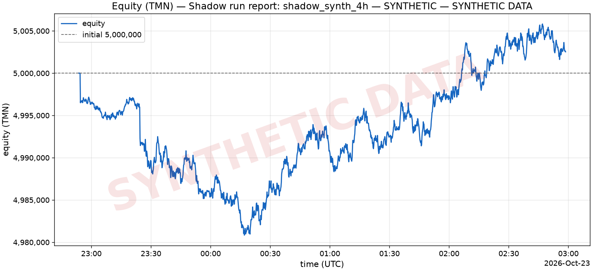

Data: [equity.csv](../docs/REPORTS/shadow_20261023_synth4h/equity.csv) (1,459 points).

### Drawdown

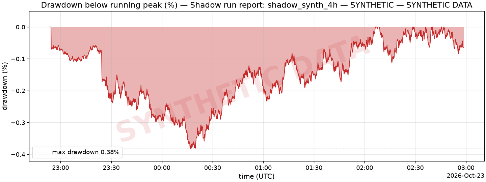

_Drawdown = (running peak − equity) / running peak; the initial equity is the first peak._

### Trades

_No trades in the window._ ([trades.csv](../docs/REPORTS/shadow_20261023_synth4h/trades.csv) has the header only.)

### Per strategy

| strategy | trades | wins | losses | win rate | PnL (TMN) | profit factor | avg PnL | avg hold | fees (TMN) | orders | vetoes |
| --- | ---: | ---: | ---: | ---: | ---: | ---: | ---: | ---: | ---: | ---: | ---: |
| S2 | 0 | 0 | 0 | n/a | 0 | n/a | n/a | n/a | n/a | 2 | 0 |

### Per day

| date (UTC) | start equity (TMN) | end equity (TMN) | return | trades | wins | trades PnL (TMN) | fees (TMN) | orders | vetoes |
| --- | ---: | ---: | ---: | ---: | ---: | ---: | ---: | ---: | ---: |
| 2026-10-22 | 5,000,000 | 4,985,645 | -0.29% | 0 | 0 | 0 | n/a | 2 | 0 |
| 2026-10-23 | 4,985,645 | 5,002,526 | 0.34% | 0 | 0 | 0 | n/a | 0 | 0 |

### Risk vetoes

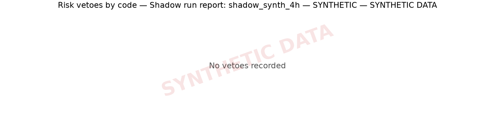

_No vetoes recorded._

Decision records: order 2, plan 38.

### S1 opportunity ticks

An opportunity tick is a fast tick on which a coin's lock-in edge reached cost + the margin in force (the plan's `s1_margin_min_pct`, else the config's) on either side, TMN-cheap or USDT-cheap. These are the engine's own counters, read from the heartbeats; best excess = the largest edge − cost − margin seen (negative: no tick reached the threshold).

| coin | ticks evaluated | opportunity ticks | best excess | last opportunity (UTC) | last why-no-trade |
|---|---:|---:|---:|---|---|
| ADA | 7,292 | 0 | -0.011% | - | no lock-in: TMN-cheap edge -0.165% < cost 0.430% + margin 0.150% and USDT-cheap edge -0.216% < cost 0.430% + margin 0.150% |
| AVAX | 7,292 | 0 | -0.261% | - | no lock-in: TMN-cheap edge -0.200% < cost 0.430% + margin 0.150% and USDT-cheap edge -0.230% < cost 0.430% + margin 0.150% |
| BTC | 7,292 | 4 | +0.138% | 2026-10-23T00:28:16.380Z | no lock-in: TMN-cheap edge -0.108% < cost 0.430% + margin 0.150% and USDT-cheap edge -0.122% < cost 0.430% + margin 0.150% |
| DOGE | 7,292 | 4 | +0.090% | 2026-10-22T23:51:50.626Z | no lock-in: TMN-cheap edge -0.154% < cost 0.430% + margin 0.150% and USDT-cheap edge -0.100% < cost 0.430% + margin 0.150% |
| ETH | 7,292 | 10 | +0.109% | 2026-10-23T02:19:35.205Z | no lock-in: TMN-cheap edge -0.051% < cost 0.430% + margin 0.150% and USDT-cheap edge -0.045% < cost 0.430% + margin 0.150% |
| LINK | 7,292 | 0 | -0.093% | - | no lock-in: TMN-cheap edge -0.167% < cost 0.430% + margin 0.150% and USDT-cheap edge -0.201% < cost 0.430% + margin 0.150% |
| LTC | 7,292 | 2 | +0.022% | 2026-10-23T01:07:21.418Z | no lock-in: TMN-cheap edge -0.190% < cost 0.430% + margin 0.150% and USDT-cheap edge -0.183% < cost 0.430% + margin 0.150% |
| SOL | 7,292 | 0 | -0.123% | - | no lock-in: TMN-cheap edge -0.227% < cost 0.430% + margin 0.150% and USDT-cheap edge -0.252% < cost 0.430% + margin 0.150% |
| TRX | 7,292 | 0 | -0.024% | - | no lock-in: TMN-cheap edge -0.202% < cost 0.430% + margin 0.150% and USDT-cheap edge -0.167% < cost 0.430% + margin 0.150% |
| XRP | 7,292 | 0 | -0.156% | - | no lock-in: TMN-cheap edge -0.127% < cost 0.430% + margin 0.150% and USDT-cheap edge -0.131% < cost 0.430% + margin 0.150% |

Total: 20 opportunity ticks in 72,920 coin-ticks evaluated. S1 entries: 0 decided, 0 placed. The analyst left S1 out of `enabled_strategies` in 38 of 38 plans (no new S1 entries while such a plan is fresh).

### AI (Regime Analyst)

| AI metric | value |
| --- | ---: |
| Plans produced | 38 |
| Average size multiplier | 0.28 |
| Plans that changed the enabled strategies | 0 |
| Plans served from the LLM cache | 0 |
| Plans with clamped fields | 1 |
| S3 entries gated by regime | 0 |
| Exits on a regime flip | 0 |
| Models | openai/gpt-5.4-mini |

Regime calls per symbol (count and share of that symbol's calls):

| symbol | trend_up | range | trend_down | chaos | calls |
| --- | ---: | ---: | ---: | ---: | ---: |
| BTCUSDT | 3 (7.89%) | 25 (65.79%) | 10 (26.32%) | 0 (0.00%) | 38 |
| ETHUSDT | 1 (2.63%) | 22 (57.89%) | 15 (39.47%) | 0 (0.00%) | 38 |
| SOLUSDT | 8 (21.05%) | 12 (31.58%) | 17 (44.74%) | 1 (2.63%) | 38 |
| USDTTMN | 3 (7.89%) | 35 (92.11%) | 0 (0.00%) | 0 (0.00%) | 38 |

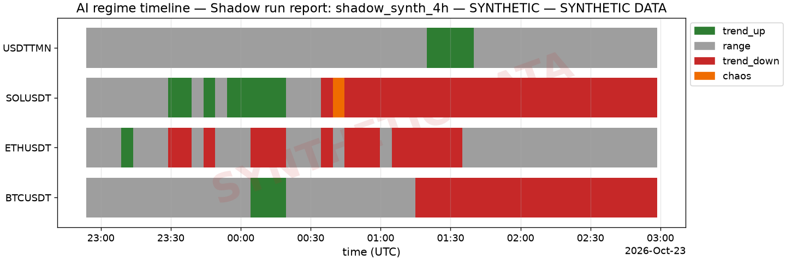

#### Analyst availability

| | value |
|---|---:|
| analyst cycles | 49 |
| plans | 38 |
| cycles without a plan | 11 |
| model calls | 86 |
| model calls served from the cache | 0 |
| tokens | 518,798 |
| post-trade reviews | 4 |

- failure streak from 2026-10-23T01:29:58.358Z: llm_invalid: an invalid answer
- failure streak from 2026-10-23T02:10:18.812Z: llm unavailable: provider unreachable
- recovered (new plan) at 2026-10-23T01:34:59.896Z
- plan stale at 2026-10-23T02:25:19.513Z: rules-only until the end of the window (2026-10-23T02:58:39.872Z, 0.56 h)

_From the heartbeats' AI counters (last value of each engine process) and the run's `ai_degraded` / `ai_recovered` / `plan_stale` events. A failure streak is logged once, at its first failed cycle._

#### Ablation (ai=on vs ai=off)

_Ablation not available yet for this run._

### Fees vs budget

| fees | value |
| --- | ---: |
| Fees paid (TMN) | 6,240 |
| Initial equity (TMN) | 5,000,000 |
| Fee budget (2.00% of initial equity over the 72-h challenge, TMN) | 100,000 |
| Budget used | 6.24% |
| Fees per 72 h at this run's pace (4.08 h of data, TMN) | 110,047 |
| Budget used per 72 h at this pace | **110.05% (over budget)** |

### Limitations

Read these before reading any number above:

- The LLM analyst gave no plan in 11 of 49 cycles (llm_invalid: an invalid answer from 2026-10-23T01:29:58.358Z; llm unavailable: provider unreachable from 2026-10-23T02:10:18.812Z); the plan went stale at 2026-10-23T02:25:19.513Z and the strategies ran rules-only until the end of the window (2026-10-23T02:58:39.872Z, 0.56 h).
- The data is synthetic (generated by the offline SyntheticFeed, not recorded from Wallex): the run exercises the code path end to end, but its returns, drawdowns and trade counts are not evidence of strategy performance.
- Shadow fills are paper fills against the live book (PaperExchange): they consume no liquidity and ignore queue position.
- Sharpe and Sortino are computed from 5 hourly returns over 4.1 h of data: reported, but not meaningful over so short a window.
- No closed trades in the window: win rate, profit factor and average PnL are undefined.
- 2,498,969 TMN was still held outside TMN (unrealized) at the end of the window; the challenge counts realized TMN only, so this run was not flattened.

---

_Generated by `backtest/report.py`. Files: [summary.json](../docs/REPORTS/shadow_20261023_synth4h/summary.json), [trades.csv](../docs/REPORTS/shadow_20261023_synth4h/trades.csv), [equity.csv](../docs/REPORTS/shadow_20261023_synth4h/equity.csv)._

---

## 13. Live challenge run

**No live run yet** (live trading is started only by the operator). No live order has been placed. A live run needs `WTA_LIVE=1` in the process environment and a clean, committed tree (`docs/DECISIONS.md`); the steps are in `docs/GO_LIVE_CHECKLIST.md`. Its report will be `python -m wta report --source logs --out docs/REPORTS/live_<date>`, which this section then embeds.

---

## 14. Replay proof (the 4-h shadow run)

_Source: [replay_20261023.md](../docs/REPORTS/replay_20261023.md) — Replay report 20261023 — SYNTHETIC, 2026-10-23._

**40/40 decisions reproduced** (PASS)

> **SYNTHETIC — not evidence of performance.** The recorded run traded on the offline synthetic feed (SYNTHETIC DATA — not evidence of performance). This report proves reproducibility of the code, nothing about strategy performance.

Recorded decisions by kind: 2 order, 2 outcome lines, 38 plan (outcome updates are joined to their decisions).

Recorded run `logs/shadow_synth_4h` (mode `shadow`, feed `synthetic`), replayed over 7292 ticks from 2026-10-22T22:53:39.782Z to 2026-10-23T02:58:38.810Z (4.08 h).

Network: 0 socket attempts, 0 LLM provider calls (both must be 0). LLM cache: 81 hits, 0 misses. Strict pass (every field, time stamps included; part of the verdict): 40/40 decisions identical.

Reproduce: `python scripts/replay_check.py --log-dir logs/shadow_synth_4h` (or `make replay`; `python -m wta replay`).

| | reference | replayed |
|---|---|---|
| decisions | 40 | 40 |
| reproduced (all compared fields equal) | 40 | |
| field mismatches | 0 | |
| missing / extra | 0 | 0 |
| aligned by order (id differs) | 0 | |
| exchange divergences | 0 | |
| outcome lines without a decision | 0 | 0 |

### Provenance

| field | reference | replayed | equal |
|---|---|---|---|
| `git_commit` | 7e8f2f5af1c55c3d744c6c8de22a454040b072f9 | e25b87b5248b1dddc40353ec1816acab378685d8 | no |
| `config_hash` | 481cc6dc3ce2 | 481cc6dc3ce2 | yes |
| `mode` | shadow | replay | no |

### Mismatches

None.

### Missing (recorded, not replayed)

None.

### Extra (replayed, never recorded)

None.

### Exchange divergences

None: every exchange answer came from the record.

### What is compared

Fields: `kind`, `strategy`, `symbol`, `intent.side`, `intent.purpose`, `intent.order_type`, `intent.qty`, `intent.notional`, `intent.price`, `intent.stop_price`, `intent.reason`, `risk.approved`, `risk.adjusted_qty`, `risk.veto_reason`, `risk.checks`, `order.accepted`, `order.request.qty`, `order.request.price`, `order.request.stop_price`, `order.response.status`, `plan.prompt_hash`, `outcome.status`, `outcome.done_reason`, `outcome.exit_reason`, `notes`, `plan.regimes`, `plan.enabled_strategies`, `plan.s1_margin_min_pct`, `plan.size_multiplier`, `plan.usdt_target_share`, `plan.risk_flags`, `plan.notes`, `plan.model`.
Numbers are compared as Decimals; risk checks by code (`code`, `passed`, `detail`).
Ignored: `config_hash`, `git_commit`, `mode`, `plan_snapshot.cached` (provenance is reported above). Time stamps and durations are compared (the replay clock runs on the recorded tick times).


### Inputs and replay run

| | |
|---|---|
| recorded log dir | `logs/shadow_synth_4h` |
| recorded state DB | `data/state_shadow4h_shadow_synthetic.sqlite` |
| recorded start | 2026-10-22T22:53:39.578Z (reason `fresh`; segment 1 of 1 replayed) |
| git commit (recorded) | `7e8f2f5af1c55c3d744c6c8de22a454040b072f9` |
| data window | 2026-10-22T22:53:39.782Z → 2026-10-23T02:58:38.810Z = 4.08 h, 7292 ticks |
| segment complete | yes: the stop event counts 7292 ticks = 7292 in the state DB |
| books put on the bus | 153132 |
| candle arrivals fed | 306179 |
| plans re-derived | 38 of 38 |
| reviewer config changes | 0 |
| injected test intents | 0 |
| config | `481cc6dc3ce2` from the given config + data.state_sqlite_path=data/state_shadow4h_{mode}.sqlite (recorded `481cc6dc3ce2`, equal) |
| markets | recorded: snapshot; replay: configs/markets_snapshot.yaml (offline snapshot) |
| exchange answers | recorded 160, repeat 22 |
| recorded records left out | decision lines after the last tick 0, decision lines of other segments 0, order lines after the last tick 0, order lines of other segments 0 |
| replay output | `replay_final2/` (temporary directory outside the repo) |

### Plans (slow loop) and config changes

| decision_id | prompt_hash | cycle | swapped in before tick | evidence | reproduced |
|---|---|---|---|---|---|
| `d_1792709619790_AI_PLAN_1` | `5cf33ad1fde5` | 2026-10-22T22:53:39.790Z | 2026-10-22T22:53:43.798Z (cache) | by tick #917 | yes |
| `d_1792709923493_AI_PLAN_2` | `39799134409e` | 2026-10-22T22:58:43.492Z | 2026-10-22T22:58:49.010Z (cache) | by tick #917 | yes |
| `d_1792710223718_AI_PLAN_3` | `fa340a9ad6b7` | 2026-10-22T23:03:43.718Z | 2026-10-22T23:03:48.471Z (cache) | by tick #917 | yes |
| `d_1792710528219_AI_PLAN_4` | `e2e2ce6efcf7` | 2026-10-22T23:08:48.218Z | 2026-10-22T23:08:56.249Z (cache) | by tick #917 | yes |
| `d_1792710830051_AI_PLAN_5` | `0eb40c636a75` | 2026-10-22T23:13:50.051Z | 2026-10-22T23:13:54.086Z (cache) | by tick #917 | yes |
| `d_1792711133753_AI_PLAN_6` | `ece4602ae195` | 2026-10-22T23:18:53.752Z | 2026-10-22T23:18:59.895Z (cache) | by tick #917 | yes |
| `d_1792711434577_AI_PLAN_7` | `78bef8d57dd8` | 2026-10-22T23:23:54.577Z | 2026-10-22T23:24:01.649Z (cache) | by tick #917 | yes |
| `d_1792711734799_AI_PLAN_8` | `d5ef083603e3` | 2026-10-22T23:28:54.799Z | 2026-10-22T23:29:01.237Z (cache) | after tick #917 | yes |
| `d_1792712035450_AI_PLAN_9` | `e1434de491e1` | 2026-10-22T23:33:55.449Z | 2026-10-22T23:34:04.837Z (cache) | after tick #917 | yes |
| `d_1792712339565_AI_PLAN_10` | `d9457b36be87` | 2026-10-22T23:38:59.565Z | 2026-10-22T23:39:06.470Z (cache) | after tick #917 | yes |
| `d_1792712640635_AI_PLAN_11` | `ca4d47e47697` | 2026-10-22T23:44:00.635Z | 2026-10-22T23:44:10.350Z (cache) | after tick #917 | yes |
| `d_1792712944499_AI_PLAN_12` | `d9e2ffee4d07` | 2026-10-22T23:49:04.498Z | 2026-10-22T23:49:09.814Z (cache) | after tick #917 | yes |
| `d_1792713249058_AI_PLAN_13` | `3e323f797777` | 2026-10-22T23:54:09.057Z | 2026-10-22T23:54:15.410Z (cache) | after tick #917 | yes |
| `d_1792713550069_AI_PLAN_14` | `045a07ce572d` | 2026-10-22T23:59:10.068Z | 2026-10-22T23:59:21.270Z (cache) | after tick #917 | yes |
| `d_1792713854669_AI_PLAN_15` | `e0ac6b51c647` | 2026-10-23T00:04:14.668Z | 2026-10-23T00:04:28.045Z (cache) | after tick #917 | yes |
| `d_1792714157305_AI_PLAN_16` | `cb8783e20c0f` | 2026-10-23T00:09:17.305Z | 2026-10-23T00:09:23.827Z (cache) | after tick #917 | yes |
| `d_1792714457589_AI_PLAN_17` | `0b57154bd494` | 2026-10-23T00:14:17.588Z | 2026-10-23T00:14:21.524Z (cache) | after tick #917 | yes |
| `d_1792714761525_AI_PLAN_18` | `65b91abcbbd0` | 2026-10-23T00:19:21.525Z | 2026-10-23T00:19:25.313Z (cache) | after tick #917 | yes |
| `d_1792715065206_AI_PLAN_19` | `8fd29d8a7bee` | 2026-10-23T00:24:25.205Z | 2026-10-23T00:24:31.090Z (cache) | after tick #917 | yes |
| `d_1792715365696_AI_PLAN_20` | `f39b53d9d9e1` | 2026-10-23T00:29:25.696Z | 2026-10-23T00:29:30.803Z (cache) | after tick #917 | yes |
| `d_1792715670068_AI_PLAN_21` | `9591537b3758` | 2026-10-23T00:34:30.068Z | 2026-10-23T00:34:40.610Z (cache) | after tick #917 | yes |
| `d_1792715973994_AI_PLAN_22` | `1f494ec4d289` | 2026-10-23T00:39:33.993Z | 2026-10-23T00:39:40.739Z (cache) | after tick #917 | yes |
| `d_1792716275009_AI_PLAN_23` | `8ac41e806867` | 2026-10-23T00:44:35.008Z | 2026-10-23T00:44:44.502Z (cache) | after tick #917 | yes |
| `d_1792716578598_AI_PLAN_24` | `ca2c013b5177` | 2026-10-23T00:49:38.597Z | 2026-10-23T00:49:42.259Z (cache) | after tick #917 | yes |
| `d_1792716882144_AI_PLAN_25` | `63f2ea3b61a1` | 2026-10-23T00:54:42.143Z | 2026-10-23T00:54:50.296Z (cache) | after tick #917 | yes |
| `d_1792717184326_AI_PLAN_26` | `dcd6f3ecaa5d` | 2026-10-23T00:59:44.325Z | 2026-10-23T00:59:51.057Z (cache) | after tick #917 | yes |
| `d_1792717485988_AI_PLAN_27` | `936210072b80` | 2026-10-23T01:04:45.988Z | 2026-10-23T01:05:00.039Z (cache) | after tick #917 | yes |
| `d_1792717789094_AI_PLAN_28` | `f6e3bada1bf6` | 2026-10-23T01:09:49.093Z | 2026-10-23T01:09:56.937Z (cache) | after tick #917 | yes |
| `d_1792718090195_AI_PLAN_29` | `a5f800b389ea` | 2026-10-23T01:14:50.195Z | 2026-10-23T01:14:59.554Z (cache) | after tick #917 | yes |
| `d_1792718394646_AI_PLAN_30` | `214230b31498` | 2026-10-23T01:19:54.646Z | 2026-10-23T01:20:01.456Z (cache) | after tick #917 | yes |
| `d_1792718694895_AI_PLAN_31` | `76911137f435` | 2026-10-23T01:24:54.894Z | 2026-10-23T01:25:03.523Z (cache) | after tick #917 | yes |
| `d_1792719299896_AI_PLAN_32` | `bf340ff58d33` | 2026-10-23T01:34:59.896Z | 2026-10-23T01:35:05.604Z (cache) | after tick #917 | yes |
| `d_1792719600204_AI_PLAN_33` | `a1d6a052b4fd` | 2026-10-23T01:40:00.204Z | 2026-10-23T01:40:08.696Z (cache) | after tick #917 | yes |
| `d_1792719902246_AI_PLAN_34` | `02995e4c6b4e` | 2026-10-23T01:45:02.246Z | 2026-10-23T01:45:05.720Z (cache) | after tick #917 | yes |
| `d_1792720205818_AI_PLAN_35` | `2a99f9051204` | 2026-10-23T01:50:05.817Z | 2026-10-23T01:50:10.843Z (cache) | after tick #917 | yes |
| `d_1792720509262_AI_PLAN_36` | `a3df5902fc83` | 2026-10-23T01:55:09.262Z | 2026-10-23T01:55:17.988Z (cache) | after tick #917 | yes |
| `d_1792720811914_AI_PLAN_37` | `3ab0f1be188c` | 2026-10-23T02:00:11.914Z | 2026-10-23T02:00:21.152Z (cache) | after tick #917 | yes |
| `d_1792721115151_AI_PLAN_38` | `2bfba4b466aa` | 2026-10-23T02:05:15.151Z | 2026-10-23T02:05:20.204Z (cache) | after tick #917 | yes |

### Strict pass (part of the verdict)

40/40 decisions identical — every field of the merged records (features with equity and balances, order answers, fees, fills, outcome PnL, time stamps and durations; only `mode`, `git_commit`, `config_hash` and `plan_snapshot.cached` are left out); known differences by construction are not counted: `plan.features.cached`.

### End state (informational, not part of the verdict)

The recorded run's final heartbeat (2026-10-23T02:58:39.836Z) against the replay's (2026-10-23T02:58:38.810Z): 16/16 values equal. The S1 counters count every fast tick on which S1 evaluated a coin and the ticks whose lock-in edge reached cost + margin, so they check the ticks without a decision too.

| value | recorded | replayed | equal |
|---|---|---|---|
| equity_tmn | 5002180.505600 | 5002180.505600 | yes |
| fees_paid_tmn | 6239.79 | 6239.79 | yes |
| realized_pnl_tmn | 0.00 | 0.00 | yes |
| open_orders | 0 | 0 | yes |
| positions | 0 | 0 | yes |
| plan_stale | true | true | yes |
| S1 ADA counters | {"best_excess_pct":"-0.0001072","evaluated":7292,"last_opportunity_ts":null,"opportunity_ticks":0} | {"best_excess_pct":"-0.0001072","evaluated":7292,"last_opportunity_ts":null,"opportunity_ticks":0} | yes |
| S1 AVAX counters | {"best_excess_pct":"-0.0026136","evaluated":7292,"last_opportunity_ts":null,"opportunity_ticks":0} | {"best_excess_pct":"-0.0026136","evaluated":7292,"last_opportunity_ts":null,"opportunity_ticks":0} | yes |
| S1 BTC counters | {"best_excess_pct":"0.0013759","evaluated":7292,"last_opportunity_ts":1792715296.380348,"opportunity_ticks":4} | {"best_excess_pct":"0.0013759","evaluated":7292,"last_opportunity_ts":1792715296.380348,"opportunity_ticks":4} | yes |
| S1 DOGE counters | {"best_excess_pct":"0.0009006","evaluated":7292,"last_opportunity_ts":1792713110.626396,"opportunity_ticks":4} | {"best_excess_pct":"0.0009006","evaluated":7292,"last_opportunity_ts":1792713110.626396,"opportunity_ticks":4} | yes |
| S1 ETH counters | {"best_excess_pct":"0.0010881","evaluated":7292,"last_opportunity_ts":1792721975.205143,"opportunity_ticks":10} | {"best_excess_pct":"0.0010881","evaluated":7292,"last_opportunity_ts":1792721975.205143,"opportunity_ticks":10} | yes |
| S1 LINK counters | {"best_excess_pct":"-0.0009299","evaluated":7292,"last_opportunity_ts":null,"opportunity_ticks":0} | {"best_excess_pct":"-0.0009299","evaluated":7292,"last_opportunity_ts":null,"opportunity_ticks":0} | yes |
| S1 LTC counters | {"best_excess_pct":"0.0002201","evaluated":7292,"last_opportunity_ts":1792717641.418607,"opportunity_ticks":2} | {"best_excess_pct":"0.0002201","evaluated":7292,"last_opportunity_ts":1792717641.418607,"opportunity_ticks":2} | yes |
| S1 SOL counters | {"best_excess_pct":"-0.0012310","evaluated":7292,"last_opportunity_ts":null,"opportunity_ticks":0} | {"best_excess_pct":"-0.0012310","evaluated":7292,"last_opportunity_ts":null,"opportunity_ticks":0} | yes |
| S1 TRX counters | {"best_excess_pct":"-0.0002382","evaluated":7292,"last_opportunity_ts":null,"opportunity_ticks":0} | {"best_excess_pct":"-0.0002382","evaluated":7292,"last_opportunity_ts":null,"opportunity_ticks":0} | yes |
| S1 XRP counters | {"best_excess_pct":"-0.0015569","evaluated":7292,"last_opportunity_ts":null,"opportunity_ticks":0} | {"best_excess_pct":"-0.0015569","evaluated":7292,"last_opportunity_ts":null,"opportunity_ticks":0} | yes |

### Limitations

- SYNTHETIC — not evidence of performance: the recorded run used the offline synthetic feed.
- The slow loop is not re-run on a timer: each recorded plan is re-derived from the LLM cache and tape and swapped in before the first tick after its recorded swap; heartbeats are not replayed.
- Exchange answers come from the record (ReplayExchange: same client ids, recorded fills and balance rows; its documented approximations apply). Two runner rules on top: the startup seed read gets the startup reconcile's balances row, and a balance refresh with no exchange-side change since the previous answer gets that answer without using up a recorded row (0 such reads).
- The recorded analyst ran 49 cycles and made 38 plans; 11 cycles gave no plan (2 failure streak(s) from 2026-10-23T01:29:58.358Z, 2026-10-23T02:10:18.812Z; recovered 2026-10-23T01:34:59.896Z). A cycle without a plan writes no decision record, so there is nothing to re-derive for it; the plan in force ages on the tick clock in the replay exactly as in the recorded engine (Engine.current_plan, ai.plan_stale_s), so after the recorded plan_stale event(s) (2026-10-23T02:25:19.513Z) both runs trade rules-only. The slow loop's own events (ai_degraded, ai_recovered, plan_stale) are not re-emitted.
