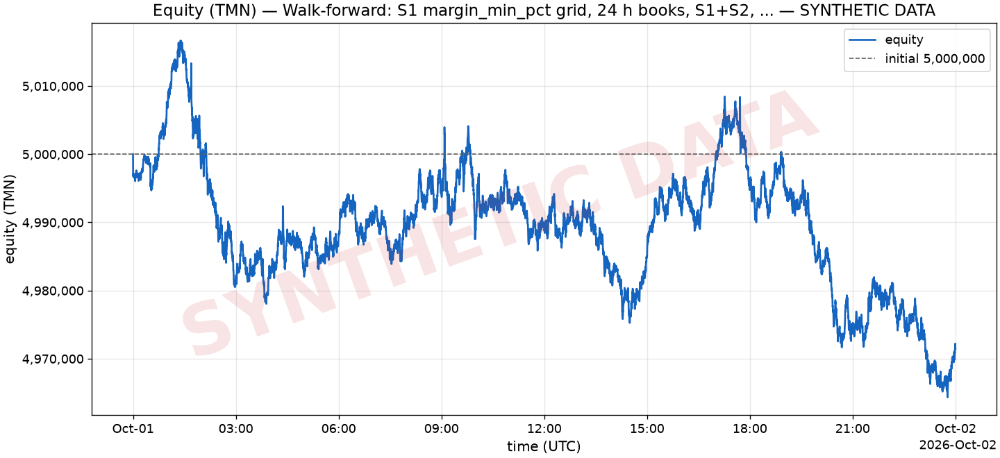
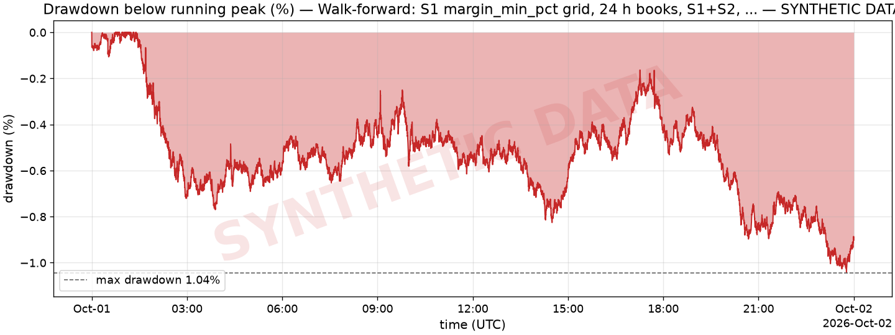
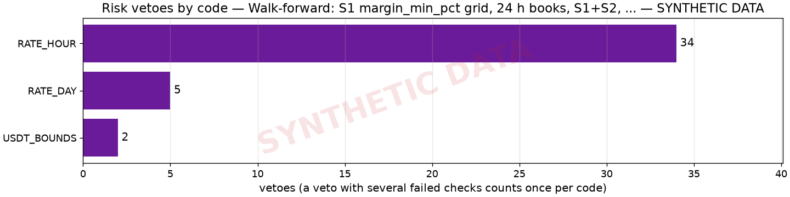

# Walk-forward: S1 margin_min_pct grid, 24 h books, S1+S2, ai=off — SYNTHETIC

> **SYNTHETIC DATA — not evidence of performance.** This run used generated market data (offline SyntheticFeed), not data recorded from Wallex. It proves the pipeline runs end to end; it proves nothing about returns.

| run | value |
| --- | --- |
| Config hash | `c76fea1dcafa` |
| Git commit | `e25b87b5248b1dddc40353ec1816acab378685d8` |
| Mode | backtest |
| Driver | books |
| Requested window (UTC) | 2026-10-01T00:00:00Z → 2026-10-02T00:00:00Z (24.0 h) |
| Data present (UTC) | 2026-10-01T00:00:00Z → 2026-10-02T00:00:00Z (24.0 h) |
| Data source | SYNTHETIC generated market DB synth_books_24h.sqlite (seed 42, hours 24.0, step_s 2.0, volume_model feed) (SYNTHETIC) |
| AI | off |
| Strategies | S1, S2 |
| Data end (UTC) | 2026-10-02T00:00:00Z |
| Report date | 2026-10-23 (commit date of e25b87b5248b + uncommitted changes) |
| ai_source | disabled |
| candles_ingested | 10,080 |
| coverage_hours | 24.00 |
| fee_budget_pct | 2.00% |
| fees_source | configs/fees_snapshot.yaml |
| flatten_at_end | no |
| git_dirty | yes |
| initial_equity_tmn | 5,000,000 |
| market_db | synth_books_24h.sqlite |
| orders_stopped_by_gaps | 0 |
| s1_coverage_hours | 24.00 |
| seed | 42 |
| snapshots | 302,407 |
| state_db | state_walkforward.sqlite |
| step_s | 2 s |
| synthetic_note | synthetic market data: an offline exercise of the engine, never evidence of performance |
| tick_crashes | 0 |
| ticks | 43,201 |
| trades_published | 0 |
| warmup_candles | 0 |

## Metrics

| metric | value |
| --- | ---: |
| Initial equity (TMN) | 5,000,000 |
| Final equity (TMN) | 4,971,429 |
| PnL (TMN) | -28,571 |
| Return | -0.57% |
| Max drawdown (below running peak) | 1.04% |
| Longest drawdown | 22h 36m |
| Sharpe (annualized, from 1-h returns) | -16.63 |
| Sortino (annualized, from 1-h returns) | -19.42 |
| Closed trades / cycles | 4 |
| Winning trades | 0 |
| Losing trades | 4 |
| Win rate | 0.00% |
| Profit factor | 0.00 |
| Average PnL per trade | -0.23% |
| Average hold | 1m 35s |
| Gross profit (TMN) | 0 |
| Gross loss (TMN) | 9,126 |
| Closed trades PnL (TMN) | -9,126 |
| Orders placed | 42 |
| Risk vetoes | 39 |
| Repeated vetoes suppressed in the log | 0 |
| Fees paid (TMN) | 30,384 |
| Fees / initial equity | 0.61% |
| Turnover (TMN) | n/a |
| Days of data | 1.00 |
| Equity points | 8,641 |
| Hourly returns (Sharpe/Sortino sample) | 24 |

_Percentages are shown ×100; [summary.json](summary.json) has every metric, including the nested breakdowns, with percentages as fractions (0.012 = 1.2%)._

Notes on the metrics:

- 1.0 days of data (24 hourly returns) — do not over-interpret
- Sources: fees from given.

### End state: realized vs unrealized

| end of window | value |
| --- | ---: |
| TMN cash | 2,477,327 |
| USDT held (TMN value) | 2,472,448 |
| Coins held (TMN value) | 21,654 |
| Equity (TMN) | 4,971,429 |
| Realized PnL (TMN cash − initial equity) | -2,522,673 |
| Unrealized at the end (equity − TMN cash) | 2,494,102 |
| Unrealized share of equity | 50.17% |
| Flat (all TMN) | no |
| Source | valuation |

## Equity curve (TMN)

Data: [equity.csv](equity.csv) (8,641 points).

## Drawdown

_Drawdown = (running peak − equity) / running peak; the initial equity is the first peak._

## Trades

Showing all 4 trades; full list (all columns): [trades.csv](trades.csv).

| entry_ts | closed_ts | strategy | symbol | pnl_tmn | pnl_pct | fees_tmn | hold_s | exit_reason | position_id | decision_id |
| --- | --- | --- | --- | --- | --- | --- | --- | --- | --- | --- |
| 2026-10-01T01:41:50Z | 2026-10-01T01:43:38Z | S1 | ETHUSDT | -1,359 | -0.14% | 2,294 | 1m 48s | target | p_S1_ETHUSDT_1790818910000_1 | d_1790818908000_S1_ETHUSDT_1 |
| 2026-10-01T04:22:12Z | 2026-10-01T04:24:08Z | S1 | ETHUSDT | -3,343 | -0.34% | 2,583 | 1m 56s | target | p_S1_ETHUSDT_1790828532000_2 | d_1790828522000_S1_ETHUSDT_1 |
| 2026-10-01T09:05:12Z | 2026-10-01T09:07:10Z | S1 | ETHUSDT | -2,470 | -0.25% | 2,596 | 1m 58s | target | p_S1_ETHUSDT_1790845512000_3 | d_1790845510000_S1_ETHUSDT_1 |
| 2026-10-01T17:42:46Z | 2026-10-01T17:43:24Z | S1 | ETHUSDT | -1,953 | -0.20% | 4,277 | 38 s | lockin | p_S1_ETHUSDT_1790876566000_4 | d_1790876564000_S1_ETHUSDT_1 |

Exit reasons: target 3, lockin 1.

## Per strategy

| strategy | trades | wins | losses | win rate | PnL (TMN) | profit factor | avg PnL | avg hold | fees (TMN) | orders | vetoes |
| --- | ---: | ---: | ---: | ---: | ---: | ---: | ---: | ---: | ---: | ---: | ---: |
| S1 | 4 | 0 | 4 | 0.00% | -9,126 | 0.00 | -0.23% | 1m 35s | 11,749 | 34 | 9 |
| S2 | 0 | 0 | 0 | n/a | 0 | n/a | n/a | n/a | n/a | 8 | 30 |

## Per day

| date (UTC) | start equity (TMN) | end equity (TMN) | return | trades | wins | trades PnL (TMN) | fees (TMN) | orders | vetoes |
| --- | ---: | ---: | ---: | ---: | ---: | ---: | ---: | ---: | ---: |
| 2026-10-01 | 5,000,000 | 4,971,985 | -0.56% | 4 | 0 | -9,126 | 11,749 | 42 | 39 |
| 2026-10-02 | 4,971,985 | 4,971,429 | -0.01% | 0 | 0 | 0 | n/a | 0 | 0 |

## Risk vetoes

| risk code | vetoes | share |
| --- | ---: | ---: |
| RATE_HOUR | 34 | 82.93% |
| RATE_DAY | 5 | 12.20% |
| USDT_BOUNDS | 2 | 4.88% |

Decision records ([decisions-20261001.jsonl](decisions-20261001.jsonl)): order 42, veto 39.

## AI (Regime Analyst)

AI was **off** in this run (rules-only defaults); no plans were produced.

| AI metric | value |
| --- | ---: |
| Plans produced | 0 |
| Average size multiplier | n/a |
| Plans that changed the enabled strategies | 0 |
| S3 entries gated by regime | 0 |
| Exits on a regime flip | 0 |

### Ablation (ai=on vs ai=off)

_Ablation not available yet for this run._

## Fees vs budget

| fees | value |
| --- | ---: |
| Fees paid (TMN) | 30,384 |
| Initial equity (TMN) | 5,000,000 |
| Fee budget (2.00% of initial equity over the 72-h challenge, TMN) | 100,000 |
| Budget used | 30.38% |
| Fees per 72 h at this run's pace (24.00 h of data, TMN) | 91,148 |
| Budget used per 72 h at this pace | 91.15% |

## Walk-forward (parameter grid)

> **SYNTHETIC DATA — not evidence of performance.** The grid was evaluated on generated data (SYNTHETIC — not evidence of performance).

- In-sample (first 70% of the data ticks): 2026-10-01T00:00:00.000Z → 2026-10-01T16:47:58.000Z
- Out-of-sample (the rest): 2026-10-01T16:48:00.000Z → 2026-10-02T00:00:00.000Z
- Choice: highest in-sample return (tie: lower in-sample drawdown). Guard: accept only if the out-of-sample return **per day of data** does not degrade more than 50% vs in-sample and is not negative, and only if the in-sample return is positive; otherwise keep the pre-grid default. Each half is a fresh paper account.
- End of every run (both halves of each candidate and the final run): no end-of-window flatten; holdings at the end are valued at the bid (unrealized), the same rule for the in-sample and the out-of-sample half.
- Data time: in-sample 16.80 h, out-of-sample 7.20 h.

| candidate | IS return | IS / day | IS max DD | IS trades | OOS return | OOS / day | OOS max DD | OOS trades | |
|---|---:|---:|---:|---:|---:|---:|---:|---:|---|
| margin_min_pct=0.0008 | -0.050% | -0.071% | 0.951% | 6 | -0.840% | -2.801% | 1.040% | 3 |  |
| margin_min_pct=0.0012 | -0.086% | -0.123% | 0.826% | 3 | -0.840% | -2.801% | 1.040% | 3 |  |
| margin_min_pct=0.0015 (default) | -0.086% | -0.123% | 0.826% | 3 | -0.900% | -3.001% | 1.100% | 3 |  |
| margin_min_pct=0.0025 | +0.141% | +0.202% | 0.600% | 2 | -0.602% | -2.008% | 0.808% | 0 | chosen |

**Decision: REJECTED.** Chosen in-sample: margin_min_pct=0.0025. out-of-sample return per day -2.0080% is negative while in-sample is +0.2020%; the pre-grid default is kept. Final parameters: margin_min_pct=0.0015.

_Returns are fractions of the starting equity of each half (shown ×100). Few trades in a half make this comparison weak; read the trade counts first._

## Limitations

Read these before reading any number above:

- SYNTHETIC — not evidence of performance: the market data was generated (seed 42, hours 24.0, step_s 2.0, volume_model feed), not recorded from Wallex.
- Parameters from the walk-forward grid (walkforward.md): margin_min_pct=0.0015 (pre-grid default).
- Book window = 24.00 h of generated (synthetic) data (43,201 ticks of 2 s with a snapshot, 302,407 snapshots) inside a requested window of 24.0 h; time without snapshots is skipped, not simulated.
- S1 cross-book coverage (USDTTMN and one coin's TMN and USDT books all fresh at once): 24.00 h.
- No data in the window for: ADATMN, ADAUSDT, AVAXTMN, AVAXUSDT, DOGETMN, DOGEUSDT, LINKTMN, LINKUSDT, LTCTMN, LTCUSDT, TRXTMN, TRXUSDT, XRPTMN, XRPUSDT (left out of the watchlist).
- No candles before the window: S2/S3 indicators warm up inside it (EMA60 of 15-minute bars needs 15 h, S3's breakout 21 bars).
- No end-of-window flatten: holdings at the end are valued at the bid (unrealized).
- The data is synthetic (generated by the offline SyntheticFeed, not recorded from Wallex): the run exercises the code path end to end, but its returns, drawdowns and trade counts are not evidence of strategy performance.
- S1 backtest window limited to generated (synthetic) 24.0 h of order books.
- Fills come from the pessimistic book fill model: an order is matched only against a newer snapshot than the one it was placed on, and takes at most 80% of each level's quantity per snapshot, minus what our earlier fills took from that level while it is still shown (recorded snapshots do not reflect our fills); the taker fee is paid on every fill of an order that was crossing at placement (STOP_LIMIT: at its trigger), the maker fee only by a LIMIT resting when placed; real queue position is not modelled.
- AI disabled (ai=off): rules-only defaults; the AI's contribution shows only in the ablation.
- Sharpe and Sortino are computed from 24 hourly returns over 24 h of data: reported, but not meaningful over so short a window.
- 2,494,102 TMN was still held outside TMN (unrealized) at the end of the window; the challenge counts realized TMN only, so this run was not flattened.

---

_Generated by `backtest/report.py`. Files: [summary.json](summary.json), [trades.csv](trades.csv), [equity.csv](equity.csv)._
