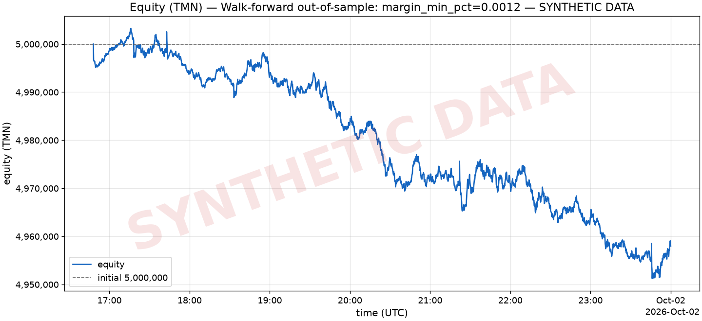
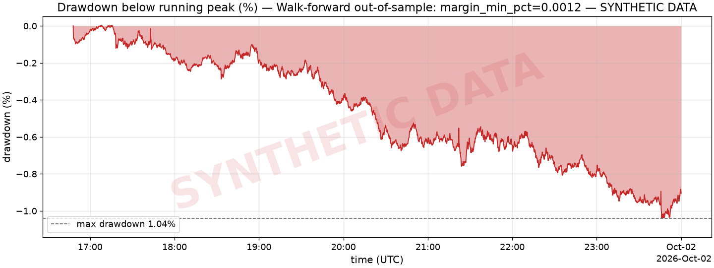
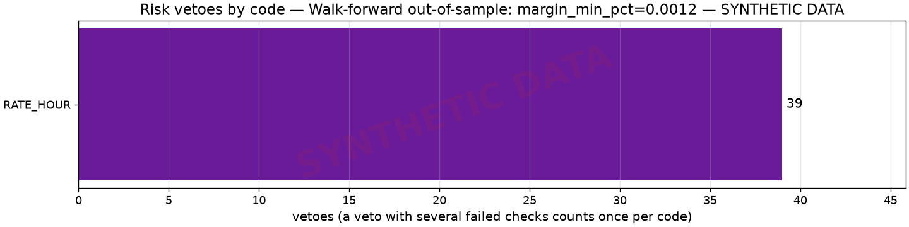

# Walk-forward out-of-sample: margin_min_pct=0.0012

> **SYNTHETIC DATA — not evidence of performance.** This run used generated market data (offline SyntheticFeed), not data recorded from Wallex. It proves the pipeline runs end to end; it proves nothing about returns.

| run | value |
| --- | --- |
| Config hash | `90b9e92cff51` |
| Git commit | `e25b87b5248b1dddc40353ec1816acab378685d8` |
| Mode | backtest |
| Driver | books |
| Requested window (UTC) | 2026-10-01T16:48:00Z → 2026-10-02T00:00:00Z (7.2 h) |
| Data present (UTC) | 2026-10-01T16:48:00Z → 2026-10-02T00:00:00Z (7.2 h) |
| Data source | SYNTHETIC generated market DB synth_books_24h.sqlite (seed 42, hours 24.0, step_s 2.0, volume_model feed) (SYNTHETIC) |
| AI | off |
| Strategies | S1, S2 |
| Data end (UTC) | 2026-10-02T00:00:00Z |
| Report date | 2026-10-23 (commit date of e25b87b5248b + uncommitted changes) |
| ai_source | disabled |
| candles_ingested | 3,031 |
| coverage_hours | 7.20 |
| fee_budget_pct | 2.00% |
| fees_source | configs/fees_snapshot.yaml |
| flatten_at_end | no |
| git_dirty | yes |
| initial_equity_tmn | 5,000,000 |
| market_db | synth_books_24h.sqlite |
| orders_stopped_by_gaps | 0 |
| s1_coverage_hours | 7.20 |
| seed | 42 |
| snapshots | 90,727 |
| state_db | state_walkforward.sqlite |
| step_s | 2 s |
| synthetic_note | synthetic market data: an offline exercise of the engine, never evidence of performance |
| tick_crashes | 0 |
| ticks | 12,961 |
| trades_published | 0 |
| warmup_candles | 7,049 |

## Metrics

| metric | value |
| --- | ---: |
| Initial equity (TMN) | 5,000,000 |
| Final equity (TMN) | 4,957,981 |
| PnL (TMN) | -42,019 |
| Return | -0.84% |
| Max drawdown (below running peak) | 1.04% |
| Longest drawdown | 6h 44m |
| Sharpe (annualized, from 1-h returns) | -117.22 |
| Sortino (annualized, from 1-h returns) | -74.99 |
| Closed trades / cycles | 3 |
| Winning trades | 0 |
| Losing trades | 3 |
| Win rate | 0.00% |
| Profit factor | 0.00 |
| Average PnL per trade | -0.30% |
| Average hold | 1m 16s |
| Gross profit (TMN) | 0 |
| Gross loss (TMN) | 8,785 |
| Closed trades PnL (TMN) | -8,785 |
| Orders placed | 26 |
| Risk vetoes | 39 |
| Repeated vetoes suppressed in the log | 0 |
| Fees paid (TMN) | 25,256 |
| Fees / initial equity | 0.51% |
| Turnover (TMN) | n/a |
| Days of data | 0.30 |
| Equity points | 2,593 |
| Hourly returns (Sharpe/Sortino sample) | 8 |

_Percentages are shown ×100; [summary.json](summary.json) has every metric, including the nested breakdowns, with percentages as fractions (0.012 = 1.2%)._

Notes on the metrics:

- 0.3 days of data (8 hourly returns) — do not over-interpret
- Sources: fees from given.

### End state: realized vs unrealized

| end of window | value |
| --- | ---: |
| TMN cash | 1,487,286 |
| USDT held (TMN value) | 3,438,332 |
| Coins held (TMN value) | 32,363 |
| Equity (TMN) | 4,957,981 |
| Realized PnL (TMN cash − initial equity) | -3,512,714 |
| Unrealized at the end (equity − TMN cash) | 3,470,695 |
| Unrealized share of equity | 70.00% |
| Flat (all TMN) | no |
| Source | valuation |

## Equity curve (TMN)

Data: [equity.csv](equity.csv) (2,593 points).

## Drawdown

_Drawdown = (running peak − equity) / running peak; the initial equity is the first peak._

## Trades

Showing all 3 trades; full list (all columns): [trades.csv](trades.csv).

| entry_ts | closed_ts | strategy | symbol | pnl_tmn | pnl_pct | fees_tmn | hold_s | exit_reason | position_id | decision_id |
| --- | --- | --- | --- | --- | --- | --- | --- | --- | --- | --- |
| 2026-10-01T17:42:46Z | 2026-10-01T17:43:24Z | S1 | ETHUSDT | -1,953 | -0.20% | 4,277 | 38 s | lockin | p_S1_ETHUSDT_1790876566000_1 | d_1790876564000_S1_ETHUSDT_1 |
| 2026-10-01T21:22:00Z | 2026-10-01T21:23:42Z | S1 | ETHUSDT | -4,457 | -0.45% | 2,577 | 1m 42s | target | p_S1_ETHUSDT_1790889720000_2 | d_1790889718000_S1_ETHUSDT_1 |
| 2026-10-01T23:45:34Z | 2026-10-01T23:47:02Z | S1 | BTCUSDT | -2,374 | -0.24% | 2,238 | 1m 28s | target | p_S1_BTCUSDT_1790898334000_3 | d_1790898322000_S1_BTCUSDT_1 |

Exit reasons: target 2, lockin 1.

## Per strategy

| strategy | trades | wins | losses | win rate | PnL (TMN) | profit factor | avg PnL | avg hold | fees (TMN) | orders | vetoes |
| --- | ---: | ---: | ---: | ---: | ---: | ---: | ---: | ---: | ---: | ---: | ---: |
| S1 | 3 | 0 | 3 | 0.00% | -8,785 | 0.00 | -0.30% | 1m 16s | 9,093 | 18 | 3 |
| S2 | 0 | 0 | 0 | n/a | 0 | n/a | n/a | n/a | n/a | 8 | 36 |

## Per day

| date (UTC) | start equity (TMN) | end equity (TMN) | return | trades | wins | trades PnL (TMN) | fees (TMN) | orders | vetoes |
| --- | ---: | ---: | ---: | ---: | ---: | ---: | ---: | ---: | ---: |
| 2026-10-01 | 5,000,000 | 4,958,755 | -0.82% | 3 | 0 | -8,785 | 9,093 | 26 | 39 |
| 2026-10-02 | 4,958,755 | 4,957,981 | -0.02% | 0 | 0 | 0 | n/a | 0 | 0 |

## Risk vetoes

| risk code | vetoes | share |
| --- | ---: | ---: |
| RATE_HOUR | 39 | 100.00% |

Decision records ([decisions-20261001.jsonl](decisions-20261001.jsonl)): order 26, veto 39.

## AI (Regime Analyst)

AI was **off** in this run (rules-only defaults); no plans were produced.

| AI metric | value |
| --- | ---: |
| Plans produced | 0 |
| Average size multiplier | n/a |
| Plans that changed the enabled strategies | 0 |
| S3 entries gated by regime | 0 |
| Exits on a regime flip | 0 |

### Ablation (ai=on vs ai=off)

_Ablation not available yet for this run._

## Fees vs budget

| fees | value |
| --- | ---: |
| Fees paid (TMN) | 25,256 |
| Initial equity (TMN) | 5,000,000 |
| Fee budget (2.00% of initial equity over the 72-h challenge, TMN) | 100,000 |
| Budget used | 25.26% |
| Fees per 72 h at this run's pace (7.20 h of data, TMN) | 252,541 |
| Budget used per 72 h at this pace | **252.54% (over budget)** |

## Limitations

Read these before reading any number above:

- SYNTHETIC — not evidence of performance: the market data was generated (seed 42, hours 24.0, step_s 2.0, volume_model feed), not recorded from Wallex.
- Book window = 7.20 h of generated (synthetic) data (12,961 ticks of 2 s with a snapshot, 90,727 snapshots) inside a requested window of 7.2 h; time without snapshots is skipped, not simulated.
- S1 cross-book coverage (USDTTMN and one coin's TMN and USDT books all fresh at once): 7.20 h.
- No data in the window for: ADATMN, ADAUSDT, AVAXTMN, AVAXUSDT, DOGETMN, DOGEUSDT, LINKTMN, LINKUSDT, LTCTMN, LTCUSDT, TRXTMN, TRXUSDT, XRPTMN, XRPUSDT (left out of the watchlist).
- Indicator warm-up: 7,049 1-minute candles (16.8 h) from before the window were preloaded (the live engine loads up to 26 h at startup).
- No end-of-window flatten: holdings at the end are valued at the bid (unrealized).
- The data is synthetic (generated by the offline SyntheticFeed, not recorded from Wallex): the run exercises the code path end to end, but its returns, drawdowns and trade counts are not evidence of strategy performance.
- S1 backtest window limited to generated (synthetic) 7.2 h of order books.
- Fills come from the pessimistic book fill model: an order is matched only against a newer snapshot than the one it was placed on, and takes at most 80% of each level's quantity per snapshot, minus what our earlier fills took from that level while it is still shown (recorded snapshots do not reflect our fills); the taker fee is paid on every fill of an order that was crossing at placement (STOP_LIMIT: at its trigger), the maker fee only by a LIMIT resting when placed; real queue position is not modelled.
- AI disabled (ai=off): rules-only defaults; the AI's contribution shows only in the ablation.
- Sharpe and Sortino are computed from 8 hourly returns over 7.2 h of data: reported, but not meaningful over so short a window.
- 3,470,695 TMN was still held outside TMN (unrealized) at the end of the window; the challenge counts realized TMN only, so this run was not flattened.

---

_Generated by `backtest/report.py`. Files: [summary.json](summary.json), [trades.csv](trades.csv), [equity.csv](equity.csv)._
